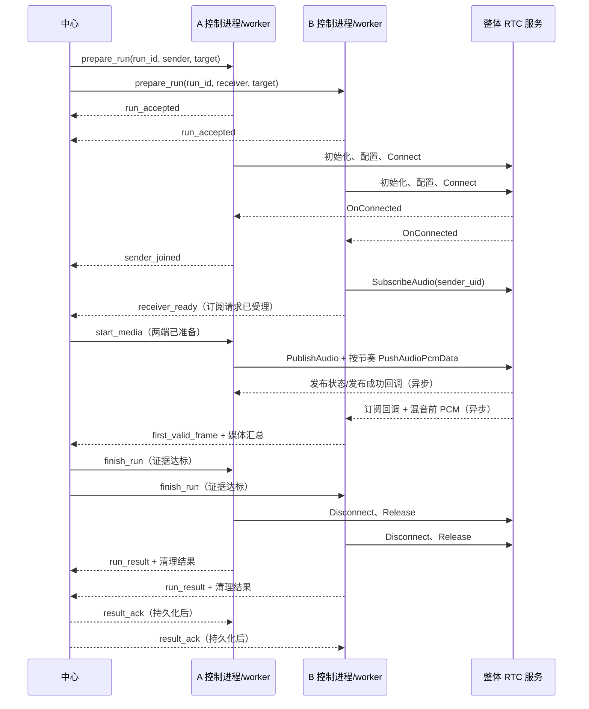

# RTC Linux SDK 2.6.6 探测客户端评估

日期：2026-11-16。依据本地 `Agora-Golang-Server-SDK-2.6.6` 源码及 RTC V1.1 PRD V0.2。

本文包含选型评估与探测客户端设计草案。第 7–12 章补充重点原生头文件、Go 接口与回调、调用时序、过程数据上报和日志回捞；协议名、路径和资源默认值属于待实现设计。

最新实施约束见第 15 章：已切换真实 SDK，单探针/单 Service/双连接，固定 demo PCM＋I420 素材，页面不提供媒体模板和编码参数配置。

第 16 章进一步明确原样 SDK 依赖边界：SDK 代码修改已撤回，所有调用与日志采集放在独立集成工程。

本次设计索引：

- 第 7 章：重点头文件、Go 桥接边界与签名问题。
- 第 8–9 章：方法清单、双端时序、重点回调及有效媒体证据。
- 第 10 章：方法/回调事件、关联字段、WSS 上报与中心展示。
- 第 11–12 章：日志回捞、保留/传输预算、实施顺序和验收。

## 1. 结论与验证范围

**可以作为 V1.1 RTC 黑盒探测客户端的候选 SDK，首期采用 Linux x86_64、合成 PCM 音频、发送和接收两个独立端。** 源码已提供外部音频发送、按频道和发布者接收解码帧、连接状态、统计及私有化接入接口。正式选型仍需在目标私有化部署上完成编译、收发和故障验收。

已完成 Go 源码、依赖脚本、示例与 PRD 对照，并临时读取安装脚本指定的 Linux 原生包内 C 头文件，完成重点回调的 C 函数指针类型核对。未修改 SDK 或现有监控代码，未连接业务频道。工程目录尚未安装 `agora_sdk` 原生头文件与动态库。宿主为 macOS arm64；初次尝试 `GOPROXY=off GOWORK=off go build ./go_sdk/rtc` 时，当前 Go 环境先报工具链版本不匹配（go1.24.8 / go1.21.0）；默认 Docker 端点也不可用。因此没有 Linux 编译、动态库加载、私有化互通或性能测试通过的结论。头文件核对新增发现三项统计回调签名不匹配，须按第 7.3 节处理后再运行探测。

### 1.1 探测对象与结果归属

探测对象是一个整体 RTC 服务，验证该服务在指定探测路径上能否完成鉴权、加入频道、发布、订阅及媒体接收。`target_id` 标识整体 RTC 服务，其配置包含服务名称、AppID、私有化接入参数及测试身份；AP 地址集合用于接入该服务。集群关联用于组织和展示服务归属。

中心维护“整体 RTC 服务（`target_id`）→ 探测任务（`task_id`，含模板与 A/B 路径）→ 单轮执行（`run_id`）”的关系。结果通过中心已保存的执行记录归入整体服务，不通过上报来源 IP 或容器位置推断归属；业务探测结果不要求填写 `node_id` 或容器 ID。

页面在整体 RTC 服务下展示已配置路径的功能状态、最近成功时间和失败阶段。成功表示该模板在已配置路径上验证通过；失败表示该路径上的服务功能验证未通过。单容器状态继续由现有容器监控表达，RTC 功能探测不直接生成某个容器故障的结论，也不触发容器重启。

## 2. 与 V1.1 需求的对应关系

| 需求 | 已有接口或证据 | 探针需要补齐 |
|---|---|---|
| 无声卡运行 | `AgoraServiceConfig.EnableAudioDevice=false`，可启用音频处理 | 关闭设备采集播放；不依赖麦克风、扬声器 |
| 两端加入 | `RtcConnection.Connect`、`RtcConnectionObserver.OnConnected` | A/B 不同 UID；两端都成功且回调属于当前轮次 |
| 私有化接入 | `SetLocalAccessPoint`、`LocalAccessPointConfiguration` | 现场 AP、域名校验、鉴权与严格目标路径验证 |
| 合成音频发布 | `PublishAudio`、`PushAudioPcmData` | 本地生成非静音 PCM；按节奏送帧并检查每次返回值 |
| 发布状态 | `OnAudioTrackPublishSuccess`、`OnAudioPublishStateChanged` | 记录阶段证据；最终成功仍须接收证据 |
| 指定发布者订阅 | `LocalUser.SubscribeAudio(uid)` | 仅订阅本轮预期发送端 |
| 有效帧接收 | `AudioFrameObserver.OnPlaybackAudioFrameBeforeMixing` | 校验频道、UID、格式、长度、帧数和持续时间 |
| 诊断数据 | `OnLocalAudioTrackStatistics`；远端音频统计桥接待修复 | 优先记录送帧与有效接收计数；远端统计须完成第 7.3 节修复后启用，不作为首期 MOS 门限 |
| Token | `Connect`、`RenewToken`；示例含 Token builder | 使用专用测试身份与短期 Token，明确签发故障归类 |
| 视频扩展 | `PushVideoFrame`、`PushVideoEncodedData`、`RegisterVideoFrameObserver` | 独立验证编码、解码和实际帧证据后启用视频模板 |
| 单轮清理 | `Disconnect`、连接 `Release`、服务 `Release` | 停止发送、退出回调、限时清理及进程兜底 |

主要源码：

- [服务初始化与私有化接入](../Agora-Golang-Server-SDK-2.6.6/go_sdk/rtc/agora_service.go)
- [连接、观察者、发送与生命周期](../Agora-Golang-Server-SDK-2.6.6/go_sdk/rtc/rtc_connection.go)
- [按发布者订阅](../Agora-Golang-Server-SDK-2.6.6/go_sdk/rtc/local_user.go)
- [PCM 接收回调桥接](../Agora-Golang-Server-SDK-2.6.6/go_sdk/rtc/audio_observer.go)
- [PCM 数据结构](../Agora-Golang-Server-SDK-2.6.6/go_sdk/rtc/audio_pcm_data_sender.go)

## 3. 部署与依赖

1. Go 封装目录版本为 2.6.6；安装脚本最终选择的 Linux x86_64 原生包为 `v4.6.31.135_28737_SERVER_20260930_1604_1321736_external-20260824_1848-3a.zip`。上线需同时锁定封装源码、原生库与校验和，不能仅记录“2.6.6”。
2. README 要求 Ubuntu 18.04+、Go 1.21+，但 `go.mod` 写的是 1.20。工程基线按 README 至少采用 Go 1.21，并使用统一、已验证的构建镜像。
3. 需要 CGO、C 编译器、原生头文件和 `.so`；不是纯 Go 单文件静态部署。运行时配置 `LD_LIBRARY_PATH` 或打包可控的 rpath。优先采用 glibc 系发行版。
4. 链接声明包含 `agora_rtc_sdk`、`agora-fdkaac`、`aosl` 和 `agora_uap_aed`。VAD 即使业务不启用，当前 `audio_vad.go` 仍参与编译和链接。实际 GLIBC、GLIBCXX 与传递依赖以最终原生库的 `ldd/readelf` 结果为准。
5. 默认 `!avcodec` 的 `opus_decoder_pure.go` 仍声明 `#cgo pkg-config: libavformat libavcodec libavutil libswresample` 和 `-DUSE_AVCODEC`，导致普通构建也引入 FFmpeg。不能按 README 假定基础音频探测不需要 FFmpeg。应通过受控补丁修正默认构建依赖，或先完整打包匹配的 FFmpeg 运行库；本次未修改。
6. `Initialize()` 无条件调用 `EnableHighVideoEncoder()`，即使配置 `EnableVideo=false`。首次离线打包保留完整匹配 SDK 物料，再按 Linux 实测结果决定裁剪；初始化返回 0 也不能证明全部扩展加载成功。
7. ARM 下载地址停留在旧版 `4.4.32.163`，与 x86_64 的 `4.6.31.135` 不一致。不能把脚本支持识别 ARM 当作当前 Go 封装已通过 ARM 验证。
8. 离线交付时提前下载、校验和固化物料；现场启动不执行 `make deps`。安装脚本会替换 SDK 目录，下载校验也不足以承担发布物完整性检查。

## 4. 对客户端设计有直接影响的问题

### 4.1 AppID 与私有化接入配置属于进程级

`agoraService` 是全局单例。`Initialize()` 发现已初始化便直接返回 0，不会验证新 AppID，也不会切换到新的 AppID。`SetLocalAccessPoint()` 同样作用于服务实例。

因此不同 AppID 或不同接入目标不要在同一个 SDK 进程内并发切换。建议首期按“每轮、每端一个工作进程”隔离；未来确有吞吐需求时，再按固定目标和固定 AppID 建进程池。每个工作进程仅初始化一次服务。

### 4.2 私有化能力已有入口，现场兼容性仍待验证

源码包含 `IPList`、`DomainList`、`VerifyDomainName`、`Mode`、`DisableAut`。按源码说明，在 `NewRtcConnection()` 后、`Connect()` 前调用 `SetLocalAccessPoint()`，并检查返回值。

黑盒探测需要证明流量经过配置目标。优先评估 `LocalProxyModeLocalOnly`，通过断开目标、抓取网络证据等方式确认不会回退公网。不能照搬示例的 `ConnectivityFirst` 模式。`DisableAut` 的具体现场语义及取值不能只凭名称推断，需结合私有化版本和鉴权方案验证。

原生头文件补充确认：`LOCAL_PROXY_MODE_CONNECTIVITY_FIRST` 明确允许本地代理连接失败后回退 SDRTN，`LOCAL_PROXY_MODE_LOCAL_ONLY` 仅连接本地代理；`disable_aut` 的注释是是否禁用 vos-aut。Go 配置默认零值为 false，与原生注释所述默认 true 不同，任务必须显式配置并完成现场验证。

### 4.3 示例是接口演示，存在不适合长期探测的写法

`send_recv_pcm.go` 使用固定发送 UID 100、订阅 UID 200，带有硬编码 `rtc.vocs_list` 测试地址；连接回调向无缓冲 channel 写入，主流程无超时等待，多个 SDK 调用未检查返回值。示例还在部分回调中调用 SDK，与 README 的回调约束冲突。

正式客户端重新实现控制流程：回调仅更新受保护状态或向有界队列非阻塞投递事件；订阅、发布、断连、释放都在控制 goroutine 执行。检查同步返回码，同时等待异步成功或失败事件。

### 4.4 已确认的小额 C 内存泄漏

`rtc_connection.go` 的 `Connect()` 在第 830 行调用 `cInfo := C.CString(info)`，随后只释放 channel、token、uid，没有释放 `cInfo`。即使传空字符串也会发生分配。

上线前应按原生参数所有权约定核对并修复；每轮工作进程退出可以限制当前影响，但不替代修复。此问题不能据此推断其他原生资源已经安全。

### 4.5 清理返回不等于全部原生资源已释放

默认 `IdleMode=true`，连接 `Release()` 会将部分原生销毁延后约 2 秒。发送 goroutine 退出前不能并发清理；不得在回调中断连或释放。父进程设置业务超时与独立清理宽限，宽限后终止仍未退出的工作进程，记录清理异常。SDK 崩溃或卡死归类为监控侧 ERROR。

### 4.6 音频默认场景偏向 AI 服务

服务和发布配置工厂默认 `AudioScenarioAiServer`，可能引入 AIQoS 能力协商。监控首期建议显式选择经目标版本验证的常规音频场景（如 `AudioScenarioDefault` 或 `AudioScenarioChorus`），并保持服务与发布配置一致；不照搬 AI 示例的其他私有参数。

### 4.7 SDK 会直接打印标准输出

服务初始化、连接及清理路径存在 `fmt.Printf`。工作进程结果应写入专用结果文件或独立 IPC 通道，SDK 标准输出作为日志处理；不能假设 stdout 只有一条 JSON。日志上传前脱敏，Token 不通过命令行参数传递。

## 5. 建议的首期执行流程

中心调度 ⇄ WSS ⇄ A/B 位置各自独立的 `rtc_probe` 服务 → 本轮 SDK 工作进程 → 整体 RTC 服务。两端通过各自的 WSS 连接上报执行证据，中心按执行记录聚合。

`rtc_probe` 容器与现有上报服务分开。现有 Docker Agent/上报服务负责容器采集；`rtc_probe` 自身包含常驻控制进程，主动连接中心，负责探针身份、心跳、任务接收、SDK 工作进程看护及结果上报。SDK 工作进程只执行单轮媒体业务，控制进程通过独立 IPC 通道收集其结果。RTC 探针身份独立于现有 Docker Agent 凭证。中心负责整体服务目标配置、同任务不重入、配置版本、新鲜度、防抖、历史与通知。

1. 中心为整体 RTC 服务目标及其任务生成 `run_id`，保存 `target_id`、`task_id`、配置版本和 A/B 探针绑定，生成单轮专用随机频道和 A/B 不同的数值 UID，准备与身份、频道绑定的短期 Token。
2. 两端分别初始化服务、创建连接、配置私有化接入、注册观察者。接收端关闭本地发布、禁用自动订阅；发送端开启 PCM 发布。
3. 两端加入成功；B 在控制流程中订阅 A，并报告接收准备完成。中心协调 A 开始发送，允许异步回调的实际顺序不同。
4. A 生成 16 kHz、单声道、PCM16 非静音合成信号，以 10 ms / 320 字节或经过验证的固定帧长发送；使用节奏控制，检查每次 `PushAudioPcmData()` 返回值，避免一次塞入大量音频。
5. B 只接收当前轮次绑定连接、当前频道和预期 UID 的帧；校验 PCM 格式与缓冲区长度，记录首次有效帧、帧数、样本数、有效媒体时长和接收窗口。
6. 两端停止媒体、断连、释放连接，最后释放服务并退出。工作进程结果携带独立的业务结果和清理结果。

同机运行两端可用于最小验证，产品页面必须标记“同机探测”。A→B 仅证明该方向；若需要双向覆盖，显式增加 B→A 阶段或另一条任务。

### WebSocket 控制与上报

建议增加独立探针入口 `/api/v1/probe/connect`，由探针主动建立 WSS 连接，握手时认证独立 `probe_id` 及凭证。该入口为设计建议，当前尚未实现。中心通过已认证身份维护探针会话，并下发该探针获准执行的任务。对同一探针的新旧连接使用会话代次隔离，旧连接不能继续受理指令或覆盖当前状态。

| 方向 | 消息 | 用途 |
|---|---|---|
| 探针 → 中心 | `hello` / `heartbeat` | SDK 版本、音视频能力、可用槽位及运行中执行摘要 |
| 中心 → 探针 | `prepare_run` | 本轮目标参数、角色、频道、身份、配置版本与执行有效期 |
| 探针 → 中心 | `run_accepted` / `stage_event` | 确认受理，以及初始化、加入和接收就绪等阶段证据 |
| 中心 → 探针 | `start_media` / `cancel_run` | 两端准备完成后开始送帧，或取消本轮 |
| 探针 → 中心 | `run_result` | 本端的业务证据、阶段原因及清理结果 |
| 中心 → 探针 | `result_ack` | 结果已持久化，探针可以清理对应待确认结果 |

业务消息携带协议版本、`message_id`、`run_id`、配置版本及端角色；中心保存执行与整体服务 `target_id` 的映射，按探针身份校验任务归属。心跳消息按探针会话关联，不要求携带执行 ID。

WebSocket 负责传输，可靠执行需要应用层保证：

- 指令带唯一标识；重复准备或开始同一执行时返回已有状态，不重复启动工作进程。收到指令的 ACK 与执行完成分开表达。
- 最终结果先进入探针的有界持久队列，中心入库后才 ACK；断线重传保持相同结果标识，中心幂等接收。队列满或存储失败须可见并限制新任务。
- 连接断开后停止接收新任务，已经执行的任务只在本轮有效期内继续，并按期限清理。重连先核对运行中执行与未确认结果，不追赶断线期间的积压轮次。
- 中心重启后的重连用于核对与清理旧执行、补交历史证据；当前业务状态等待新的有效轮次恢复。迟到、已取消、已过期或旧配置的结果只能按规则进入历史，不能覆盖最新状态。
- Ping/Pong 用于发现连接失效；应用心跳表达本地执行能力。连接在线、探针可执行与整体 RTC 服务功能状态分别维护；服务正常必须有新鲜的有效媒体证据。
- 每条连接采用单独读循环、串行写队列、读写期限及消息/队列大小限制；SDK 回调不直接操作 WebSocket。阶段上报不能阻塞媒体接收，取消指令和最终结果需要明确的队列处理策略。
- 连接只传控制消息、统计及必要诊断，不传 PCM/YUV 原始帧；接入凭证通过受保护通道分发并从日志脱敏。

现有参考实现位于 `monitor/internal/center/http.go` 的 Agent WebSocket 处理及 `monitor/cmd/agent/main.go`：已具备心跳、超时、重连、任务与结果 ACK 模式。复用其通信机制时，为 RTC 定义独立消息、身份和存储语义，避免与容器操作记录混用。

### 成功条件与证据

- 两端加入同一专用会话，A 实际提交了合成 PCM，B 收到本轮预期发布者的有效帧。
- 建议试验起点：收到累计至少 1 秒的有效音频，并在规定窗口内持续观察接收；这只是待实测冻结的门限，不修改 PRD 的默认值。
- 为避免将静音补帧当作有效业务，建议在 B 的后台处理流程验证合成信号的能量和频率特征；若要证明具体内容来自本轮，则使用本轮变化的音频模式。编码后的 PCM 不做字节级完全相等比较。
- 频道、UID、run_id 和配置版本共同隔离旧证据；不能仅以回调到达时间判断归属。关闭本轮后到达的回调直接忽略。
- B 记录的接收等待时延可以使用本机单调时钟；跨主机单向媒体时延需要时钟同步等额外条件，不能直接相减两端墙上时间。

最小结果建议包含：`run_id`、`task_id`、配置版本、目标与路径、两端探针标识、封装/原生 SDK 版本、各阶段起止/原因码、发送成功字节与次数、接收有效帧/样本/时长、首帧等待、业务结果、清理结果。中心通过 `run_id` 查询已绑定的整体服务目标，校验上报身份、配置版本、有效期及两端证据后才生成 SUCCESS；结果携带的目标字段必须与执行记录一致，不能单凭 A 的报告判成功。

鉴权被目标拒绝、加入失败、发布失败和接收超时，在已有效执行的情况下归 FAILED；SDK 初始化、工作进程异常、本地资源不足和 Token 供应不可用归 ERROR；停用或配置变更取消归 CANCELLED。ERROR 不累计业务连续失败。业务已成功而清理失败时保留两项事实，不伪造业务失败或恢复。

## 6. 正式接入前的最小验收

| 验证 | 需要得到的证据 |
|---|---|
| Linux 构建与离线启动 | 匹配的头文件与原生库可编译；`ldd` 无缺失；无公网下载可启动 |
| 目标互通 | 当前 SDK 对目标私有化版本可鉴权、加入、收发；记录所有准确版本 |
| 路径限制 | 目标阻断后无法通过其他路径继续成功，证明目标绑定有效 |
| 正常音频 | 两端加入、A 送帧、B 收到正确发布者和有效信号 |
| 加入但不送帧 | 达到接收超时后 FAILED，不能因加入或发布回调而成功 |
| 旧轮次与错误 UID | 迟到、错误频道/UID 和旧配置结果不计入新轮次 |
| 故障与取消 | 无效 Token、目标不可达、探针失联、工作进程退出、停用的分类和阶段准确 |
| 反复执行与并发 | 按 PRD 初始规模重复运行，记录 RSS、FD、线程、CPU、退出耗时，确定明确并发上限 |
| 清理超时 | 超过宽限可回收工作进程；中心可见清理异常且不无限占用任务 |

下一实施落点应是独立 RTC 探针的单轮音频收发验证，再接中心协议、调度和页面。视频与 ARM 以各自实测结果单独承诺。

## 7. 重点头文件与接口边界

### 7.1 核对来源

原生头文件来自安装脚本最终指定的 [Linux x86_64 原生包](https://download.agora.io/sdk/release/shengwang_rtc_sdk.v4.6.31.135_28737_SERVER_20260930_1604_1321736_external-20260824_1848-3a.zip)。本次按 ZIP 条目读取其中 `include/c/api2` 与 `include/c/base` 的头文件，并与本地 Go/C 桥接逐项比对；头文件读取不代表动态库已通过运行验证。后续构建必须使用同一发行包配套的头文件与动态库。

| 重点头文件（相对 `agora_sdk/include/c/`） | 探测关注的声明 | 对应 Go 封装与用途 |
|---|---|---|
| `api2/agora_service.h` | `agora_service_config`、`agora_service_create/initialize/release`、`agora_service_set_local_access_point` | `agora_service.go`：初始化、目标接入、日志配置、服务释放 |
| `api2/agora_rtc_conn.h` | `rtc_conn_config`、`rtc_conn_info`、`rtc_conn_observer`、`agora_rtc_conn_create/connect/disconnect/renew_token/register_observer` | `rtc_connection.go`、`rtc_callbacks.go`：连接生命周期、鉴权及远端身份 |
| `api2/agora_local_user.h` | `local_user_observer`、`agora_local_user_publish_audio/subscribe_audio`、帧参数及观察者注册 | `local_user.go`、`rtc_connection.go`：发布、订阅、媒体状态与帧观察者 |
| `api2/agora_media_node_factory.h` | PCM sender 的创建、`agora_audio_pcm_data_sender_send` 和销毁 | `media_node_factory.go`、`audio_pcm_data_sender.go`：合成 PCM 的底层送入路径 |
| `api2/agora_audio_track.h` | 本地音轨控制、`remote_audio_track_stats` | `local_audio_track.go`；远端统计桥接修复时依据本头文件核对结构体 |
| `base/agora_media_base.h` | `audio_frame`、`audio_params`、`audio_frame_observer`、`AUDIO_FRAME_POSITION` | `AudioFrame` 与 PCM 帧校验；观察混音前位置 `0x0008` |
| `base/agora_base.h` | `local_access_point_configuration`、`LOCAL_PROXY_MODE`、基础身份与统计结构 | 私有化目标参数、模式、状态原值和统计字段 |
| `base/agora_log.h` | `log_config`、日志大小 KB 约定 | 日志配置的原生参考；Go 探针实际通过服务初始化配置日志 |
| `base/agora_parameter.h` | `agora_parameter_set_parameters` | `AgoraParameter.SetParameters`：仅开放经过验证的参数白名单 |

Go 仓库中的 `rtc_callbacks_cgo.h/.c`、`audio_observer_cgo.h/.c` 是桥接层，需与原生声明一起看；视频后续涉及 `video_observer_cgo.h/.c`、`agora_video_track.h` 和 `agora_video_frame.h`。`agora_error.h` 内含多项 WebSocket 端点错误枚举，不能把它当作所有 RTC 返回码和连接 reason 的统一字典。

### 7.2 原生已有而当前 Go 层未开放的重点回调

| 原生回调 | 当前 Go 暴露情况 | 本期设计 |
|---|---|---|
| `rtc_conn_observer.on_api_call_executed` | `RtcConnectionObserver` 无对应字段，桥接未赋值 | 在探针 SDK 适配层包装方法调用，生成 begin/end 事件；不依赖本回调完成调用审计 |
| `on_warning`、`on_connection_license_validation_failure` | 未开放 | SDK 日志保留相关诊断；如补桥接，另加结构化事件，不把日志猜测当成精确回调原因 |
| `on_upload_log_result` | 未开放，当前 C 连接头文件也未提供对应上传入口 | 由探针回捞本地日志并上传中心，不承诺使用 SDK 自带日志上传 |
| `local_user_observer.on_audio_track_publication_failure`、`on_local_audio_track_state_changed` | 未开放 | 同步返回、已开放的发布状态与错误回调、媒体接收和超时共同判断；有歧义时保留原始证据 |
| `on_audio_subscribe_state_changed`、`on_first_remote_audio_frame/decoded` | 未开放 | 订阅返回、`OnUserAudioTrackSubscribed` 和首个有效 PCM 帧分别记录；首帧时间由探针自行测量 |
| `on_transport_stats`、`on_user_network_quality` | 未开放 | 首期不承诺这些网络指标；以明确标注来源的已有指标为准 |

上述回调是否扩展属于后续实现选择，当前设计不把它们作为首期执行前提。普通日志中看见同名字符串，也不等于收到结构化 SDK 回调。

### 7.3 头文件核对新增的接入阻塞项

三项统计回调存在函数签名不匹配：

| 原生声明 | 当前 C/Go 桥接的解释 | 影响 |
|---|---|---|
| `on_remote_audio_track_statistics(local_user, remote_track_handle, const remote_audio_track_stats*)` | 第二参数按 `user_id_t`/字符串解释，第三参数按另一种 `remote_audio_stats*` 解释 | 可能将句柄读取为字符串、读取错误结构体字段 |
| `on_local_video_track_statistics(local_user, local_track_handle, const local_video_track_stats*)` | 桥接只接两个参数，将第二参数按 stats 指针解释 | 可能把视频轨句柄当作统计结构体读取 |
| `on_remote_video_track_statistics(local_user, remote_track_handle, const remote_video_track_stats*)` | 第二参数按 UID 字符串解释 | 可能非法读取 UID 或导致崩溃 |

本次用 Clang `-fsyntax-only -Werror=incompatible-function-pointer-types` 直接对上述原生字段赋桥接函数指针，得到三项类型错误；另外选取连接、音频发布/订阅、PCM 与本地音频统计共 21 个重点桥接声明，同类检查通过。这只是声明层检查，不是 Linux 执行或内存安全验收。

处理要求：先修正相应桥接签名、结构转换及“音轨句柄 → 预期 UID”的关联；或在原生 `local_user_observer` 构造时真正将这三个回调字段置空，明确声明对应能力不可用。**仅把 Go 的统计处理函数设为 nil 不能完成原生回调的禁用**，当前 `CLocalUserObserver()` 仍会填写桥接指针。桥接修复或原生禁用完成前，不运行当前 SDK 探针。首期功能成功证据使用送帧计数与有效 PCM 接收计数，不依赖这些统计。

另外两项会影响过程数据的真实性：

- `RegisterObserver()`、`RegisterAudioFrameObserver()` 忽略原生注册接口的 int 返回值并返回 0；`Disconnect()` 也忽略若干内部清理返回值。需要适配补丁透传/采集内部结果，或者把当前事件明确标记为“Go 封装返回”，不能据此声称原生注册、注销全部成功。
- Go 注释把 `AgoraServiceConfig.LogSize` 描述为 Byte，但转换代码将其直接写入原生 `log_file_size_kb`。配置和界面统一按 **KB**，例如 `5 * 1024` 表示约 5 MB，避免日志大小失控。

## 8. 作为探测逻辑的重点方法与调用时序

### 8.1 首期模板与参数

首期模板名建议 `rtc_audio_pcm_v1`。A 为发送端、B 为接收端；中心为整体 RTC 服务生成本轮身份、频道、配置版本和期限。发送/接收能力分别在探针 hello 中声明；未完成第 7.3 节处理时不声明可执行能力。

| 配置 | 首期建议 |
|---|---|
| 服务 | `EnableAudioProcessor=true`、`EnableAudioDevice=false`、`EnableVideo=false`、`UseStringUid=false`；显式设置已验证的常规 `AudioScenario` |
| 连接 | 双端关闭自动音视频订阅与声卡采集播放；PCM 模板关闭仅收 RTP/编码帧模式；使用已验证的 channel profile/type |
| 发布 | A 使用 `NewRtcConPublishConfig()` 后显式设置 `IsPublishAudio=true`、PCM、无视频；B 设置 `IsPublishAudio=false`、`IsPublishVideo=false` |
| 接收观察位置 | B 的 `OnGetAudioFramePosition` 显式返回 `AUDIO_FRAME_POSITION_BEFORE_MIXING`（`0x0008`）；当前 Go 层没有同名常量，可由适配层定义具名常量 |
| PCM 输出参数 | B 调用 `SetPlaybackAudioFrameBeforeMixingParameters(1, 16000)`；接收时仍检查实际格式 |
| 合成输入 | A 生成 16 kHz、单声道、PCM16，10 ms 为 160 个样本、320 字节；探针先校验非空、合法采样率及长度，再调用 SDK |
| 私有化入口 | 显式配置 AP、域名校验、`LocalOnly`、vos-aut 选项；校验 `SetLocalAccessPoint()` 返回值 |
| 本地目录 | 每轮、每端、每个 worker 独立设置 `LogPath`、`ConfigDir`、`DataDir`，启动前创建并检查可写性 |

不依赖示例中大量缓冲音频、AI 加速送帧或硬编码私有参数。SDK 的 `PushAudioPcmData` 注释与长度校验并非完全一致；探针自身强制 10 ms 对齐，并避免零采样率、零声道、空数据进入底层。

### 8.2 方法调用清单

表中 int 返回值按对应接口解释，通常 0 表示同步受理；每个值都保存原值。无返回值或指针返回不能伪装为 `return_code=0`。后台连接、发布和接收的业务完成须另看回调和媒体证据。

| 阶段/端 | Go 方法 | 关键原生调用 | 记录和推进条件 |
|---|---|---|---|
| INITIALIZE / A、B | `Initialize(serviceConfig)` | `agora_service_create`、`agora_service_initialize` | 脱敏配置摘要、耗时、返回码；本地初始化失败归 ERROR |
| CREATE_CONNECTION / A、B | `NewRtcConnection(connConfig, publishConfig)` | `agora_rtc_conn_create`，内部创建 LocalUser、sender、track | 逻辑 connection/track ID、配置摘要；记录 pointer/void 返回语义；崩溃由父进程记录 |
| CONFIGURE_ACCESS / A、B | `SetLocalAccessPoint(config)` | `agora_service_set_local_access_point` | 目标配置引用与模式、返回码；在创建连接后且 Connect 前调用 |
| REGISTER / A、B | `RegisterObserver`、`RegisterLocalUserObserver` | 连接及 LocalUser observer 注册 | 记录启用的回调名和注册结果来源；处理第 7.3 节返回码缺口 |
| REGISTER / B | `GetLocalUser().SetPlaybackAudioFrameBeforeMixingParameters(1,16000)`；`RegisterAudioFrameObserver(observer,0,nil)` | 帧参数设置、音频 observer 注册 | 实际格式约定、观察位置、VAD 关闭；在 Connect 前配置完成 |
| JOIN / A、B | `Connect(token,channel,uid,info)` | `agora_rtc_conn_connect` | Token 仅记签发引用/期限，不记值；同步受理后等待本端 `OnConnected` |
| SUBSCRIBE / B | `GetLocalUser().SubscribeAudio(senderUID)` | `agora_local_user_subscribe_audio` | 预期发布者、返回码；同步受理后报告 `receiver_ready`，不等待实际媒体出现 |
| PUBLISH / A | `PublishAudio()` | `agora_local_user_publish_audio` | 接到中心 `start_media` 后调用；同步受理即可开始送帧，收集发布回调 |
| SEND / A | `PushAudioPcmData(pcm,16000,1,pts)` | `agora_audio_pcm_data_sender_send` | 首次调用及失败记录，持续聚合成功次数、字节、样本、送入时长和节奏偏差 |
| TOKEN / A、B，按需 | `RenewToken(newToken)` | `agora_rtc_conn_renew_token` | 仅在剩余执行时间需要时触发；记录签发引用与返回值，不记录 Token |
| CLEANUP / A、B | 停止发送/校验任务 → `Disconnect()` | 取消发布、注销媒体观察者、`agora_rtc_conn_disconnect` | 先停止本地生产者；记录返回及 `OnDisconnected`；不要求清理后再收到媒体/LocalUser 回调 |
| RELEASE / A、B | 连接 `Release()` → 服务 `Release()` → worker 退出 | 连接/track/sender 销毁、`agora_service_release` | 连接 Release 为 void；服务 Release 为 int；父进程记录退出状态与清理是否超时 |

高层调用与内部原生调用分别标记：探针包装 `NewRtcConnection()` 只能证明这次高层调用发生及是否返回；若没有给内部 create/register 增加埋点，则不能为它们虚构独立原生调用事件。包装层自身产生的 `-2000` 等错误与 SDK 原生错误需标明来源；无法确定时写 `unknown`。

### 8.3 双端协调与状态推进



`receiver_ready` 表示帧观察者已配置、本端已加入、指定 UID 的订阅请求已受理；`OnUserAudioTrackSubscribed` 可能等 A 发布后才出现。**不能先等待该订阅回调再允许 A 发布，否则可能形成互相等待。** 发布成功回调也可能依赖首次送帧，不把等待该回调作为首次 Push 的前置条件。图中的回调为示意顺序，实际事件允许交错。

端内状态建议为 `PREPARING → JOINING → READY → MEDIA_RUNNING → VERIFYING → CLEANING → FINISHED`，失败或取消从任一活动状态进入 CLEANING。A 的 READY 是本端加入，B 的 READY 还需订阅请求受理。中心生成 `start_media`、`finish_run` 和取消的幂等命令；finish 仅表示收尾要求，最终成功由中心核对两端结果。

所有阶段受同一单轮业务期限约束，不能因重连、阶段重试或 Token 更新重新计算整轮超时；清理使用 PRD 的独立宽限。中心离线时，两端仍按已下发的最大送帧时长与本地单调时钟期限停止，不无限等待 finish。业务证据达标与清理完成分别存储。

## 9. 重点回调选择与证据处理

### 9.1 连接与媒体回调

| Go 回调 | 采集字段 | 探测用途与上报策略 |
|---|---|---|
| `OnConnecting` / `OnConnected` | 连接信息快照、state、reason | 记录 JOIN 阶段；Connected 校验本轮频道和本端 UID，仅证明本端加入 |
| `OnReconnecting` / `OnReconnected` / `OnConnectionLost` | 状态、reason、本地 elapsed | 即时记录链路变化；可在原期限内继续观察，不能凭重连完成直接恢复业务正常 |
| `OnConnectionFailure` | `errCode`、连接快照 | 终止相应连接等待，按已知原因归类；不把所有错误泛化为服务故障 |
| `OnDisconnected` | reason、是否已发出本地断连、断连耗时 | 区分正常收尾与非预期断开；正常收尾不算业务异常 |
| `OnTokenPrivilegeWillExpire` / `OnTokenPrivilegeDidExpire` | 本轮身份引用、到期事件 | 回调带出的 token 字符串丢弃；交控制流程按需续签；供应失败与目标拒绝分别归类 |
| `OnUserJoined` / `OnUserLeft` | 远端 UID、离开 reason | 匹配预期对端，记录辅助证据；不作为唯一订阅触发器或收发成功条件 |
| `OnError` / `OnEncryptionError` | 错误码、脱敏且截断的文本 | 即时记录；保留事件所属阶段，按语义判定是否终止，不因任意 OnError 自动覆盖有效结果 |
| `OnAudioTrackPublishSuccess` / `OnAudioPublishStateChanged` | 逻辑 track ID、频道、old/new state、SDK elapsed | 发布阶段证据；有回调不等于已收到媒体；缺失时记录未观察到，不虚构成功回调 |
| `OnAudioTrackUnpublished` | 逻辑 track ID、是否清理中 | 收尾及非预期取消发布诊断；Disconnect 内部注销可能使此回调不再到达，不设为必到条件 |
| `OnUserAudioTrackSubscribed` | 预期 UID、逻辑 remote track ID | 记录订阅事实；remote track 的原生指针不序列化，也不留给后台异步调用 |
| `OnUserAudioTrackStateChanged` / `OnUserInfoUpdated` | UID、state/reason、elapsed、媒体标志 | 辅助解释静音、停止及接收异常；仍以有效媒体帧作成功证据 |
| `OnPlaybackAudioFrameBeforeMixing` | 频道、UID、格式、样本数、首帧时刻、帧到达间隔 | 接收核心证据；首帧事件一次，后续窗口聚合，不逐帧联网 |
| `OnGetAudioFramePosition` | 返回位置掩码 | 配置回调，固定返回混音前位置；记录配置摘要及调用次数，不当作业务事件刷屏 |
| `OnLocalAudioTrackStatistics` | 通道数、采样率、发送码率、codec | 可用时按窗口采集；短轮次未触发时记“未观察到”，不填 0 冒充测量 |
| `OnRemoteAudioTrackStatistics` | 修复后支持的实际字段和 UID 关联 | 第 7.3 节阻塞项解决后再启用；未启用时能力/指标标记 unavailable |

首期不选录音、耳返、混音后的整体音量、数据流消息或音频元数据作为媒体成功依据。视频模板后续选择 `OnVideoTrackPublishSuccess`、`OnUserVideoTrackSubscribed`、`VideoFrameObserver.OnRenderVideoFrame`，分别校验视频证据；当前视频统计同样受第 7.3 节限制。

### 9.2 PCM 有效性与首帧定义

仅对当前活动 worker/connection、预期频道与 UID 的帧计数。检查 PCM16、合法采样率和声道、`SamplesPerChannel>0`，并校验 `len(Buffer) == SamplesPerChannel × Channels × BytesPerSample`。格式发生变化时按实际采样率分段累加样本时长，不把“回调次数 × 10 ms”当作固定接收时长。

记录 `first_frame`（格式有效的首帧）与 `first_valid_signal`（后台校验通过合成信号的首段）两个时间；前者不能替代有效合成媒体证据。原生 Go 转换使用 `C.GoBytes` 复制 PCM，探针只在有界的本地校验队列短暂持有；校验能量、频率或本轮变化模式后释放，不落盘音频、不上传 PCM。VAD、人声概率不适合用来判断合成音调有效。

有效音频时长按验证通过的样本数换算；同时记录接收观测窗口、最大帧间隔、错误帧与校验丢弃计数。累计一秒音频只是一项门限，还需观察其在真实接收窗口中的分布，避免一次突发或静音补帧被判为持续媒体接收。`PresentTimeMs`/RTP 时间戳不作为未经验证的本轮身份或跨主机单向时延依据；当前 Go `AudioFrame` 也没有暴露原生全部字段。

### 9.3 回调线程约束

回调只做标识校验、字段快照、轻量计数和非阻塞投递；不能执行 SDK 操作、网络上报、日志压缩或磁盘同步。连接回调传入的 `*RtcConnectionInfo` 指向会复用的数据，必须在回调内拷贝字段，不能把原指针交给异步消费者。

独立状态归约器处理快照并驱动控制流程；回调可能先于对应 API 返回，不能要求先收到 `api_call_end` 再接受回调。跨回调并发通过锁/原子状态维护一致性，已进入清理的迟到媒体不再参与成功判定。

队列满时累加并上报 `callback_event_dropped`、`validation_queue_dropped`，保留关键状态快照与最终计数。仅诊断事件缺失标记观测不完整；若关键证据无法验证、关键状态丢失且无法从快照确认，则归 ERROR 或无法确认，不得把本地采集丢失归为整体 RTC 服务 FAILED。

## 10. 方法调用、回调与过程数据上报

### 10.1 采集分工与通道

worker 内部 SDK 适配层采集 `api_call_begin/end`，回调适配层采集 `sdk_callback`，状态机产生 `stage_event` 与 `media_summary`。worker 经专用 IPC 将这些结构化数据交常驻控制进程；控制进程负责本地持久队列、WSS 批量上报、重传和 ACK，并独立采集 worker 启停、退出码、信号与超时。

stdout/stderr 单独按原始字节流接管；其中会混有 Go 打印和原生 C 日志，不能当作结构化 IPC 或直接当作标准 JSON 解析。API 包装只记录允许的参数字段，禁止通用对象 dump 或自动打印整个回调对象。

### 10.2 统一事件字段

| 字段 | 设计约定 |
|---|---|
| 归属 | `target_id`、`task_id`、`run_id`、`config_revision`；中心以已保存任务绑定校验，目标为整体 RTC 服务 |
| 来源 | `probe_id`、`endpoint_role`、`worker_id`、逻辑 `connection_id`、版本信息；连接身份由认证确定 |
| 身份与去重 | `event_id`、`source_id`、源内递增 `source_seq`；重传保持原 ID 和内容，worker/控制进程分别使用独立 source |
| 时间 | `occurred_at` UTC、本 worker 启动后的 `monotonic_elapsed_ms`；中心另记 `received_at`，不按两个主机墙上时间强排因果 |
| 事件类型 | `worker_event`、`api_call_begin`、`api_call_end`、`sdk_callback`、`stage_event`、`media_summary`、`diagnostic_manifest` |
| 方法关联 | `call_id`、Go `api_name`、已实际观测时才填原生 `native_api_name`；回调关联明确时填 `related_call_id`，否则仅关联本轮/连接 |
| 返回与错误 | `return_kind=int/void/object`、`return_code` 可空、`return_origin=wrapper/native/unknown`、`error_domain`、原始 `reason_code`、版本化解析文本 |
| 观测完整性 | `callback_count`、`telemetry_dropped`、`validation_queue_dropped`、`truncated`、`evidence_complete` |

每个低频方法调用先记录 begin，再调用 SDK，返回后记录 end 和本地单调耗时。父进程发现 begin 无 end 且 worker 被杀死时记 `outcome=interrupted/timeout`、`return_code=null`；不伪造 SDK 返回值。以安全参数摘要记录频道、专用 UID、采样格式、配置引用；Token、证书、密钥和值未知的私有参数不进入事件。

示例：

```json
{
  "type": "api_call_end",
  "event_id": "event-b-24",
  "source_id": "worker-b-01",
  "source_seq": 24,
  "target_id": "rtc-service-beijing",
  "task_id": "audio-path-01",
  "run_id": "run-001",
  "config_revision": 3,
  "probe_id": "probe-b",
  "endpoint_role": "receiver",
  "worker_id": "worker-b-01",
  "connection_id": "connection-b-01",
  "stage": "SUBSCRIBE",
  "call_id": "call-b-08",
  "api_name": "LocalUser.SubscribeAudio",
  "native_api_name": "agora_local_user_subscribe_audio",
  "args": {"publisher_uid": "10001"},
  "occurred_at": "2026-11-16T12:00:02.140Z",
  "monotonic_elapsed_ms": 2140,
  "duration_ms": 2,
  "return_kind": "int",
  "return_origin": "native",
  "return_code": 0,
  "outcome": "accepted"
}
```

这里的 0 仅表示订阅请求同步受理；中心时间线随后还需显示订阅回调和有效媒体证据。

### 10.3 上报粒度与可靠性

| 数据 | 本地采集 | WSS 上报 |
|---|---|---|
| 初始化、接入、注册、加入、发布、订阅、续签、清理方法 | 每次 begin/end，保存参数摘要与返回来源 | 及时批量发送，保留每次失败及卡住的 begin |
| `PushAudioPcmData` | 每次调用都计数、累计样本/字节、更新耗时统计 | 首次 begin/end、首个错误及错误码计数，随后按约 1 秒窗口汇总；不用每 10 ms 发一条成功调用事件 |
| 连接变化、错误、发布、订阅回调 | 每次状态变化与原值快照 | 及时发送；重复相同事件可聚合次数和首末时间 |
| 高频帧与配置查询回调 | 首帧、轻量计数、校验结果；保留首末时间 | 首帧/首段有效信号事件及约 1 秒 `media_summary`，不传原始帧 |
| SDK 统计 | 到达次数、实际字段、采集时间 | 按窗口上报；不可用或未触发明确标记，不能补 0 |
| 最终端结果 | 包含业务证据、阶段结果、清理结果与事件完整性 | 持久化后重传直到 `result_ack`；中心独立核对两端 |
| SDK 文件与进程日志 | 本轮目录下限额保存 | 走第 11 章回捞流程，WSS 只传控制、摘要和进度 |

新增设计消息为 `telemetry_batch` / `telemetry_ack`、`finish_run`、`collect_logs`、`log_collect_status`。最终结果 ACK、过程事件 ACK 和日志包完成确认分别维护：结果已保存不意味着过程事件和日志已经到齐。

过程事件 ACK 仅确认中心已持久化的 `event_id` 集合或每个 source 连续保存的序号区间；源内存在空洞时不能越过空洞批量删除本地记录。WSS 会话更换不改变事件 ID；来源序号随新 worker/source 重建。事件可以迟到、重发、乱序，中心按 ID 去重并将历史回补与当前状态更新分开。

控制指令、关键状态/最终结果、日志上传使用各自的有界队列与配额。单写协程对控制/ACK 和最终结果保留处理机会；低优先级遥测可合并为窗口，明确报告丢弃量。持久队列写入失败时停止接新任务并报告探针异常，不在 SDK 回调内等待队列腾空。

### 10.4 中心展示与单轮结果

任务执行详情按 A/B 两列时间线展示：方法调用与受理、实际回调、媒体证据、收尾、诊断包。使用名称原值和脱敏参数，展示“未返回”“未观察到回调”“诊断数据不完整”，不把它们渲染成 0 ms 或成功。默认只显示阶段摘要，可展开具体方法和回调。

最终结果包含两端阶段起止与超时、送入成功次数/字节/样本时长、有效接收帧/样本时长、接收窗口/最大间隔、预期发布者与信号验证摘要、证据完整性、清理状态、日志可用状态。统计不能替代媒体证据，日志回捞失败不能改写已确认的业务结果；中心仍按 PRD 防抖规则生成整体服务在已配置路径上的状态。

## 11. SDK 日志与调用记录回捞设计

### 11.1 每轮本地文件组织

建议持久数据卷内目录如下，所有标识由本地校验后生成，路径不直接接受中心提供的任意字符串：

```text
/var/lib/rtc-probe/runs/<run_id>/<endpoint_role>/<worker_id>/
  manifest.json              本轮归属、版本、文件清单与保留期限
  events.jsonl               方法、回调、阶段及媒体摘要
  result.json                本端最终证据及清理结果
  process.stdout.log         Go 与原生写到 stdout 的输出
  process.stderr.log         错误输出、原生崩溃文本
  sdk/                       LogPath 指向此处，收集实际轮转文件
  config/                    SDK ConfigDir，本地使用，不纳入默认回捞
  data/                      SDK DataDir，本地使用，不纳入默认回捞
```

初始化前创建目录；设置 `LogPath=.../sdk/agorasdk.log`、明确的 KB 大小和经原生版本验证的日志级别。文件轮转命名、数量和进程退出时的刷盘行为需要 Linux 实测，不预设固定文件名后缀。SDK 原始时间戳保留其来源/时区信息；与中心关联以 run/worker 标识为准。

控制进程持续排空 stdout/stderr，达到日志限额后继续读取并丢弃超额内容、累计截断字节，避免管道写满使 SDK 阻塞。结构化记录经专用 IPC 写入 `events.jsonl`，媒体原始数据、Token 和完整配置不落入诊断文件。

诊断日志与最终结果/可靠上报队列分别计量并预留空间；接近 SDK 目录总量或磁盘预算时停止接新任务、触发归集与回收，活动 worker 按执行/清理期限退出。不能靠删除仍在写入的文件就声称已回收空间，也不能让日志占满最终结果所需空间。

### 11.2 自动与手动触发

- FAILED、ERROR、异常退出或清理超时：自动为 A/B 两端发起本轮日志归集；单端离线时显示该端暂不可用，在线端先保存证据。可合并同一轮的重复自动请求。
- 正常轮次：保留阶段/最终摘要和限时本地日志；不默认上传整包。排障时可在保留期内手动回捞。
- 具备探测诊断权限的人员从执行详情选择 run 和 A/B 端，中心生成带 `request_id`、目标文件类别、时间范围/字节上限及期限的 `collect_logs` 命令；中心记录操作者、用途和下载审计。探针只接受分配给自身且仍在保留期内的执行。

回捞状态独立为 `REQUESTED → COLLECTING → UPLOADING → AVAILABLE`，并支持 `PARTIAL`、`FAILED`、`EXPIRED`。它与业务 SUCCESS/FAILED/ERROR、清理状态分别存储；任务可已结束而日志仍在上传。

### 11.3 归集、脱敏与文件清单

1. 探针依据 run/role/worker 本地索引解析文件，不接受中心任意路径、shell 命令或目录遍历；拒绝符号链接逃逸和其他轮次文件。
2. 已退出的 worker 归集关闭后的文件；仍在运行则建立有界文件快照，记录截取 offset、大小、时间范围与是否完整，不等待媒体执行结束才响应，也不阻塞执行线程。
3. 白名单收集 `events.jsonl`、`result.json`、stdout/stderr 和实际 SDK 日志轮转文件。默认不包含 `config/`、`data/`、音视频转储或 core dump；崩溃文本、退出码与信号保留。
4. 在本地生成脱敏副本，对专用凭证、Token、证书/密钥、鉴权头及错误信息中的敏感参数做过滤；无法安全处理的内容标记省略，不把原始完整配置直接打包。SDK 可能包含调用参数，不能只依靠业务包装层脱敏。
5. 清单记录每个文件的类别、相对路径、脱敏后字节数、时间/offset 范围、截断/省略原因及 SHA-256；压缩后另算包大小和包 SHA-256。中心验证的是实际上传的脱敏包。
6. 包内 `manifest.json` 绑定 `target_id/task_id/run_id`、配置版本、probe/role/worker、SDK 与探针版本、请求 ID、清理状态和时钟信息。其他用户或旧轮次内容不得混入。

### 11.4 传输与确认

WSS 用于 `collect_logs`、上传协商及 `log_collect_status`；较大的日志包通过**同一中心的 HTTPS 接口**分块上传，复用中心 TLS 入口，避免长日志包占用控制连接。此处为拟定接口契约，不代表服务已实现。

中心给出与探针身份、本轮和请求 ID 绑定的 `upload_id`；探针按块序号、offset、块摘要上传并支持断点续传。中心按配额写入临时文件，校验大小及整包摘要后原子完成，才发“日志可用”确认。重复上传同一 request/bundle 幂等处理，未完成的临时包定期回收。

只在中心确认完整包或明确的部分包已保存后更新可用状态；上传成功不能仅依赖 HTTP 请求已经发出。中心失联时在保留/空间预算内等待重试；预算耗尽后保留缺失原因，不能无限占盘。下载经中心鉴权授权，不暴露探针文件系统地址。

### 11.5 建议起始资源参数

以下仅为实现起点，需随 Linux SDK 日志量与并发实测冻结；历史明细仍按 PRD 另行保留。

| 参数 | 建议起点与行为 |
|---|---|
| SDK 单文件大小 | `LogSize=5*1024` KB；还须设置整轮目录总量限制，不能只限单文件 |
| 常态日志级别 | 显式配置经当前原生版本确认的 INFO；短期 DEBUG 由任务版本/期限控制，不任意套用未知数字 |
| 过程上报 | 约 1 秒聚合；单批上限 128 事件且不超过 256 KiB，超长文本截断并标记 |
| 单端单轮归集输入 | 上限 20 MiB，包含 SDK 和进程日志；超限优先保留清单、结果、关键事件及故障附近日志，记录截断 |
| 单包传输 | 压缩包上限 20 MiB、单块约 256 KiB；同时检查解压后总量，接收端不自动执行包内文件 |
| 本地保留 | 成功轮次原始日志 1 小时，失败/ERROR 日志 24 小时；过期可见为 EXPIRED |
| 探针总诊断空间 | 起始预算 1 GiB，先清理过期与已确认包；空间不足影响执行时停止接新任务并标记本地资源 ERROR |
| 中心诊断包 | 起始保留 7 天并设置独立总量配额；到期后仍保留执行摘要与“日志已过期”标识 |

日志采集、压缩、传输单独限制并发/CPU/带宽，业务失败时不会同时启动无限数量的回捞任务。断线重试和人工重复点击复用已有请求或明确返回已有包。

## 12. 本次设计的实施顺序与补充验收

实施顺序：修复/禁用不匹配的原生统计桥接与注册返回缺口 → SDK 方法/回调适配及本地结构化记录 → 双端单轮状态机和有效信号验证 → WSS 控制/遥测/结果确认 → 本地日志归集与中心下载。各阶段都围绕整体 RTC 服务目标归属。

| 补充验收 | 必须验证的行为 |
|---|---|
| 原生回调契约 | 与实际发行包头文件逐个核对；三项统计桥接完成修复或原生置空，并用真实 Linux 库验证 |
| 方法同步受理/异步完成 | Connect/Publish/Subscribe 返回 0 而没有媒体时，不能判成功；回调先于 API end 也能正确处理 |
| 双端发布订阅协调 | B 订阅受理后即可准备完成，A 首次送帧不受实际订阅/发布回调的循环等待影响 |
| 调用卡住或原生崩溃 | 保留 begin 无 end、worker 退出码/信号、父进程超时证据，归监控侧 ERROR，按期限清理 |
| 高频负载与事件丢失 | 帧/送帧不逐条联网；队列满不阻塞 SDK；丢弃量与证据完整性可见 |
| 时钟、重放与重连 | A/B 时钟偏差不生成虚假延迟；事件去重、ACK、旧轮次隔离及补交历史正确 |
| SDK 日志大小和轮转 | 验证 KB 单位、实际文件名称/数量/刷盘行为；多轮并发不混日志，stdout 超限仍持续排空 |
| 自动与手动回捞 | A/B 包与请求、run、worker 对应；在线快照标明范围，离线、过期、截断和部分包可见 |
| 分块上传与中心重启 | 断点续传、重复块、摘要错误及未完成包回收正确；中心保存完成后才标记可下载 |
| 日志内容与权限 | 方法/回调/SDK 日志中的 Token 等秘密被过滤；路径越界和越权下载被拒绝；原始媒体不进入包 |
| 业务与诊断独立 | 业务成功而回捞失败时保留两项事实；诊断完成不触发虚假的业务恢复或容器故障归因 |

## 13. 框架阶段实现记录（2026-11-16）

本节记录初始框架交付；后续页面管理及远端部署已在第 14 章补充。

已建立仓库根目录 [rtc_probe 独立模块](../rtc_probe/README.md)，并接入现有中心服务。当前执行模式仅为模拟 SDK，目标始终是整体 RTC 服务；模拟成功只表示框架链路验证成功，中心 `rtc_service_status` 保持 UNKNOWN / SIMULATION_ONLY。

| 部分 | 当前实现 |
|---|---|
| SDK 边界 | `sdk.Driver` 隔离初始化、连接、订阅、发布、PCM 与释放；`sdk.Mock` 提供成功、加入失败、发布失败、无媒体、初始化错误和清理异常场景 |
| 进程结构 | 常驻探针控制进程 + 每轮独立 worker；方法/回调走专用 FD 管道，stdout/stderr 单独排空限额保存 |
| 中心连接 | `/api/v1/probe/connect`，独立探针认证、WSS 心跳/重连、能力/版本登记、旧会话隔离 |
| 调度与控制 | 配置整体服务目标与 A/B 任务；周期调度、手动执行、同任务不重入、并发上限、启停与取消 |
| 过程与结果 | 方法 begin/end、重点回调、首帧与窗口摘要；探针 outbox 重传，中心持久化后 ACK，按执行/角色校验归属 |
| 存储 | 有 PostgreSQL 时复用现有文档存储，file-dev 时使用原子文件；中心重启中断旧活动轮次，探针重启不重复执行已接受任务 |
| 日志回捞 | 失败/清理异常自动请求两端日志，支持手动回捞、ZIP 清单/摘要校验、中心鉴权下载；模拟模式明确标记原生 SDK 日志不可用 |
| 权限 | 状态复用 `monitor.read`，任务控制与诊断分别使用新增 `rtc.manage`、`rtc.diagnostics`；与容器 Agent 凭证隔离 |
| 部署与验证 | 独立 Dockerfile、环境变量配置、一键本地隔离演示、Linux amd64 纯 Go 编译；端到端测试使用真实 worker 子进程 |

本阶段目标/任务/身份参数从中心 YAML 读取，API 支持启停和运行控制；前端配置管理与展示、真实 SDK 接入、真实业务防抖/通知尚未实现。首版日志为最多 8 MiB 的 HTTPS 整包重试，分块续传、完整时间保留/磁盘预算是后续工作；第 11 章的生产方案仍作为目标设计。模拟 PCM 在接收端本地生成，A/B 之间没有真实 RTC 媒体传输。

框架验证覆盖双端执行与证据、重复事件去重、跨探针上报拒绝、旧会话隔离、取消后的迟到结果、存储失败不确认，以及两端日志归属和回捞。启动和复现入口见 [rtc_probe 使用说明](../rtc_probe/README.md) 与 [RTC Probe 使用说明](../rtc_probe/README.md)。

## 14. 页面管理与远端部署（2026-11-16）

中心页面新增“RTC 业务探测”，包含任务、目标服务、探针和执行记录四个视图。管理者可创建/编辑整体服务目标和双端任务、启停、立即执行、取消本轮和回捞日志；查看角色保持只读。执行详情按发送端/接收端展示方法调用、方法返回、SDK 回调、媒体摘要、清理状态与日志下载。页面始终明确模拟模式；同机双端明确标注“同机探测”。

目标/任务配置通过带 `expected_revision` 的 `/api/v1/rtc/config` 持久化；配置变化取消旧轮次，迟到结果留作历史，不改写新状态。探针身份与机器凭证继续由部署配置登记，页面不回显秘密。

实际部署为中心 `111.230.108.76`、探针主机 `81.71.150.26` 上两个独立容器 `rtc-probe-a` / `rtc-probe-b`，探针主动通过证书校验的 WSS 连接中心。当前采用模拟 SDK，不连接真实 RTC 媒体链路。详细测试记录、镜像及回退位置见 [RTC Probe 使用说明](../rtc_probe/README.md)。

## 15. 真实 SDK 与固定 demo 素材（最新实施）

按后续约束收敛为一个探测服务、一条 WSS、每轮一个工作进程，进程内仅初始化一次 AgoraService，创建两个 RtcConnection，UID 分别为 10001 / 10002。实际调用真实 `Agora-Golang-Server-SDK-2.6.6`，配套原生库为 4.6.31.135；生产构建不自动回退模拟接口。

固定采用官方 demo 测试包的 `send_audio_16k_1ch.pcm` 和 `send_video_cif_352x288.yuv`，按 PCM16/16 kHz/单声道与 I420/352×288/15 fps/H264 发送。参考 PCM 接收、YUV 收发示例与 send_mp4 的正时间戳/节奏处理；不增加媒体模板、分辨率/帧率/编码设置或素材上传入口。每轮发送约 5 秒，接收端同时满足至少 1 秒有效音频及 5 帧有效视频后才通过；两种媒体分别记录首帧和计数。

页面创建任务时填写 AppID、鉴权方式、App Certificate 或两端 Token、私有化 IP/域名、证书校验域名、vos-aut 设置及周期/超时。App Certificate 保留在中心；生产 PostgreSQL 加密保存 SDK 凭证，查询仅返回已配置标志，探针只接收短期 Token。

已落实第 7.3 节的安全边界：原生置空三个签名不匹配的可选统计回调；使用真实 PCM/视频帧回调作为功能证据。另补注册返回码、Connect 字符串释放、连接创建失败保护及可选插件加载控制，详见 [RTC Probe 使用说明](../rtc_probe/README.md)。

Linux CGO 编译、运行镜像自检及 SDK 视频观察者测试已通过。自检实际创建一个 Service、两个连接，注册接收视频观察者并配置视频编码器，但不调用 Connect；真实 RTC 业务验收仍须页面提供有效项目参数。原模拟执行保留为历史，旧模拟任务已退役。

## 16. SDK 原样依赖与集成层调用日志（2026-11-17）

按用户约束，SDK 本身不放业务逻辑、不改源码或回调桥接。本轮曾修改的四个文件已从原始 SDK ZIP 恢复，`go_sdk/rtc` 下 49 个 Go/C/头文件逐字节核对一致；前文关于内部补丁的描述仅为历史方案，当前不再采用。

独立 `rtc_probe` Go 工程像 examples 一样通过公开 Go API 集成 SDK。`agoranative/` 负责调用及回调处理，`telemetry/` 负责参数快照、事件关联与本地明细，`probe/` 负责持久化、WSS 上报及日志包传输。

API 记录包含实际参数、返回值类型与值、微秒耗时、call_id、service_id、connection_id。回调记录包含连接信息/UID、状态/原因/错误参数、发布/订阅音轨或视频信息、音频采样及缓冲区描述、视频格式/尺寸/stride/缓冲区描述和时间戳，并通过 related_call_id 关联对应 API。回调发生于方法返回之前也会保留真实顺序。

每次相关调用和回调逐条写入每端 `sdk-api.jsonl`；高频音视频调用在 WSS 上按每秒汇总参数与数量，首个有效帧、错误及低频方法实时上报。真实任务结束自动归集完整明细和 SDK 文件日志，中心保存后支持下载。Token 等秘密脱敏，不记录 PCM/YUV 内容；日志存储异常或丢弃数量作为监控侧错误可见。

原 SDK 默认 FFmpeg 构建依赖由独立构建环境提供，不再通过修改 SDK 规避。部分方法未透传原生返回值时只记录 Go SDK 真实返回，并明确该边界。详细边界见 [RTC Probe 使用说明](../rtc_probe/README.md)。

## 17. RTC 1.1 管理能力与真实音视频验收（2026-11-17）

本节为当前实施状态，取代前文框架阶段的模拟部署说明。中心在 `111.230.108.76`，`81.71.150.26` 上只有一个在运行的 `rtc-probe` 服务；每轮一个工作进程、一个 AgoraService、两个 RtcConnection。SDK 源码仍与发行 ZIP 一致，适配逻辑全部位于独立集成工程。

### 17.1 任务及私有化默认值

中心任务 `rtc-av-private-1145326` 对应整体目标 `rtc-private-1145326`。使用用户提供的 AppID、未启用 Token，发送 UID 10001、接收 UID 10002，独立随机频道，周期 60 秒、业务超时 30 秒。固定官方 PCM/YUV 素材，不增加媒体模板、分辨率、帧率、编码或素材配置入口。

页面默认 AP 配置：`IPList=[111.230.192.59]`、`DomainList=[111.230.192.59]`、`VerifyDomainName=ap.1145326.agora.local`、`Mode=LocalProxyModeConnectivityFirst (0)`、`DisableAut=true`。页面也支持 LocalOnly，由任务显式选择。ConnectivityFirst 具有回退语义；抓包已确认探针与指定 AP 的 TCP 8003 通信，但该证据不能单独证明所有 RTC 媒体路径均被强制限制于私有网络。

### 17.2 已补齐的中心能力

- 任务健康与单轮结果分开：默认连续失败 3 次确认异常、连续成功 2 次恢复；首次成功建立正常基线。ERROR、探针离线、停用、结果过期及未调度归为未知并中断计数。持续未知默认 120 秒后才产生通知事实。
- 任务页面支持防抖次数、未知通知等待及描述；查看最近结果、确认计数和当前健康。服务状态首页增加 RTC 摘要及管理入口。
- 页面登记独立探针并只展示一次机器凭证，支持启停。停用阻止新任务，现有连接保留至执行清理和结果/日志补交完成。
- PostgreSQL 新增 RTC 专用执行历史、管理审计和日志索引表，历史分页独立于控制用内存缓存；默认执行明细 7 天、管理审计 30 天，历史与诊断包各 512 MiB，可在页面调整。容量面板给出当前用量和按每日计划轮数估算的数据量。
- 历史清理按批次执行，范围仅限 RTC 表及诊断目录；不删除 V1.0 账本。历史日志过期可见，回捞可以复用现有包或建立新请求。
- 新增 RTC 异常、恢复、持续未知通知分类，复用持久队列、HMAC 和同一事件重试；以任务/整体服务标识归属。端点必须明确订阅 RTC 分类，既有订阅不自动扩大。配置变更、停用或删除会撤销尚未完成的旧任务通知。

数据库建表交由 owner 迁移，运行账号仅验证表是否存在并使用原有 DML 权限。增量 SQL 为 `monitor/internal/postgres/rtc_history.sql`，新安装的 `dbmigrate` 已内置此脚本。

### 17.3 真实验收及兼容处理

真实执行已观察到两端 OnConnected、发送端音/视频发布成功、接收端音/视频订阅回调、有效 PCM 与 I420 帧。成功轮次 `8698107435bc536b3dde5ea3cbcabce3` 收到 457 帧有效音频（4.57 秒）和 73 帧 352×288 视频；发送端提交约 500 帧 PCM 和 74–75 帧视频。后续周期轮次也已通过，中心由新鲜媒体证据显示 HEALTHY。

实测发现当前原生 SDK 的 `OnPlaybackAudioFrameBeforeMixing` 可能返回空 `channelId`。集成层保留空字符串原值，并增加 `connection_channel_id` 和 `channel_from_connection`：仅在该观察者所属接收连接已通过 OnConnected 的频道/本地 UID 校验、远端 UID 等于发送 UID、帧格式/长度及有效能量均符合条件时计入；非空但不匹配的频道仍拒绝。未改 SDK 桥接或生成回调。

过程记录保存每次真实 API/回调和参数描述，中心接收秒级聚合。上报增加相同待确认消息的重试间隔，优先发送结果，避免慢中心被重复就绪消息及重复批次占满。发送时间戳的日志与实际传参复用同一变量。

诊断包下载后核对 ZIP SHA-256、manifest 中每个文件摘要及角色/run 归属，API/回调完整、丢弃数为 0。原生 SDK 日志包含二进制格式，最新实现按 `sdk/agora*.log` 原文件分别保存，避免拼接后影响解码；每个文件记录大小、摘要及截断状态，SDK 日志合计读取上限 4 MiB。

### 17.4 验证边界与交付

Go race 测试、中心 Go 测试、TypeScript 检查与前端构建通过；Linux 原生镜像在 `--network none` 下完成对象自检，再通过真实中心任务验收加入/发布/收发。浏览器已确认中心域名可打开登录页；入口为 `https://demo.edge.rtcdevelopers.com:19443/`。本机已有 hosts 映射，其他机器须配置 DNS/hosts；直接使用 IP 不匹配当前证书。

离线交付为现有中心的 RTC 增量镜像及独立探针镜像，附校验清单、迁移与升级回退说明；包含 SDK/FFmpeg/系统运行依赖、CA 和固定素材，无业务凭证。现阶段不将以下内容描述为已完成：10 任务规模压测、ARM 验证、SDK 原生质量统计桥接修复、分块断点续传。日志仍为最多 8 MiB 的 HTTPS 整包重试；探针原始记录按约 100 轮已确认执行保留，按整轮清理，尚未实现第 11 章建议的成功/失败分时保留及 1 GiB 总预算。管理审计已独立保留，所有关键健康变化的独立 30 天审计仍需补充，当前可从执行历史追溯。

最新镜像、离线包位置和实际验收数字见 [RTC Probe 使用说明](../rtc_probe/README.md)。

最终稳定性收尾：控制文档只缓存最近 4 个已完成且不再等待日志的执行，活动执行/待上传诊断仍保留；完整历史留在专表，避免旧明细反复序列化拖慢控制消息。清理宽限 10 秒、结果上报再留 5 秒；等待开始指令超时为 `ERROR/CONTROL_START_TIMEOUT`，不计作 RTC 业务失败。缓存调整后的真实轮次约 6.8 秒完成，中心结果接收约晚 0.5 秒。

## 18. RTC 1.1 完成版（2026-11-17）

当前以本节及 [RTC Probe 使用说明](../rtc_probe/README.md) 为准。第 17 章所列分块续传、探针分时保留/总磁盘预算、独立 30 天健康变化审计和十任务验收均已完成；先前模拟部署、SDK 内部补丁及未完成条目为历史记录。SDK 本身原样依赖，生产始终运行真实双媒体，固定官方 demo 文件。

新增中心下发的探针策略、按块断点上传、ZIP CRC/文件摘要验证、完整/过程快照区分、关键健康变化原子审计、阶段耗时、进程退出诊断及离开回调等待。默认中心历史/诊断各 2 GiB，探针成功日志 1 小时、失败 24 小时、预算 1 GiB；预算优先回收已确认日志，未确认数据保护及暂停行为已验证。

真实无媒体/缺音频/缺视频均得到正确失败。十个不同任务在单服务两个工作进程中通过，批次间隔 30 秒；目标在密集建连时返回连接原因 10（服务端拒绝），该限制保留为已验证的运行边界，没有用重试掩盖。生产配置为一个工作进程、每 60 秒一轮。

发布镜像为 avops-center:rtc11-release-20261117 与 rtc-probe:sdk-rtc11-release-20261117，探针版本 0.3.0。[RTC Probe 使用说明](../rtc_probe/README.md) 及 [RTC Probe 使用说明](../rtc_probe/README.md) 已补齐。ARM、质量统计/MOS、RTM 和自动重启不属于已冻结的 RTC 1.1 范围。

## 19. UDP media edge 按端口范围逐个探测（2026-11-17）

用户确认“一次任务执行顺序检查完整端口范围”。新增任务配置 rtc.media_edges：enabled、host、start_port、end_port。默认范围示例 4001–4008，最多 64 个端口；启用时页面将原 60 秒周期调整为 600 秒，可自行修改，单端口/会话超时独立。

父执行 EDGE_SWEEP 汇总整体服务本轮结果，按升序依次创建真实子执行。每个子执行独立工作进程，初始化后通过公开 GetAgoraParameter().SetParameters 设置单元素 rtc.vos_list，随后创建发送/接收连接并加入。每次选择的 IP:port 均进入参数日志、事件和执行归属；SDK 源码不改。一个端口失败仍继续后续端口，全部成功才本轮成功，失败/恢复阈值按完整范围计数。

真实 4001–4003 测试证据：4001 有效音频 4550 ms、视频 73 帧，通过；4002 和 4003 当前未监听，均 JOIN_TIMEOUT，父执行最终失败。抓包确认对 4002 的实际 UDP 请求。正式中心下发 4001 单端口范围再验收成功，音频 4570 ms、视频 72 帧，SetParameters 返回 0，两端日志可下载。现场目前只发现 4001 监听，不宣称已运行 4001–4008 全部进程。

详情见 [RTC Probe 使用说明](../rtc_probe/README.md)。中心镜像 avops-center:rtc11-edges-20261117，探针镜像 rtc-probe:sdk-rtc11-edges-20261117，探针版本 0.4.0。


## 20. 目标服务统一接入与鉴权配置（2026-11-17）

目标仍表示整体 RTC 服务。创建目标时统一填写 AppID、鉴权与凭证、频道/UID、私有化 AP 参数、UDP media edge 地址与端口范围。创建任务只选择目标、执行探针、调度/超时及阈值，自动读取目标配置并展示只读摘要。一个目标可供多个任务共享。

中心按 target_id 加密保存凭证；管理查询不回显，仅显示目标凭证已配置。发起执行时解析目标到 Job.RTC，签发必要的短期 Token，并保留该轮参数快照。修改目标只取消其关联任务旧轮次，历史执行使用原快照。任务不能覆盖已配置目标的 RTC 参数或写入凭证。

旧任务配置和凭证启动时自动迁移。同一旧目标原有不同配置/凭证组合时自动建立迁移目标并重关联，避免覆盖；相同组合合并，重复启动不会再次拆分。AppID/鉴权模式/固定频道或预签发 Token 的 UID 改变时，保存须提交新凭证。

中心已发布 avops-center:rtc11-targets-20261117，探针继续使用 0.4.0。迁移后真实执行 282ca2f0c1008501dea06e5a9d0523f7：SUCCESS/MEDIA_VERIFIED，有效音频 4570 ms、视频 73 帧，双端日志 AVAILABLE，整体 HEALTHY。现有任务升级前实际为 600 秒周期、30 秒超时，本次原样保留。台账版本保持 2112bd3ae34c1556dc409e5ed01f1c38。

测试覆盖共享配置/凭证、选择性取消、历史快照、冲突配置迁移与幂等、凭证作用域变化后的原子拒绝。隔离页面验证创建目标、任务关联、只读摘要、修改目标后任务同步。上线与回退资料见 rtc_probe/README.md。
