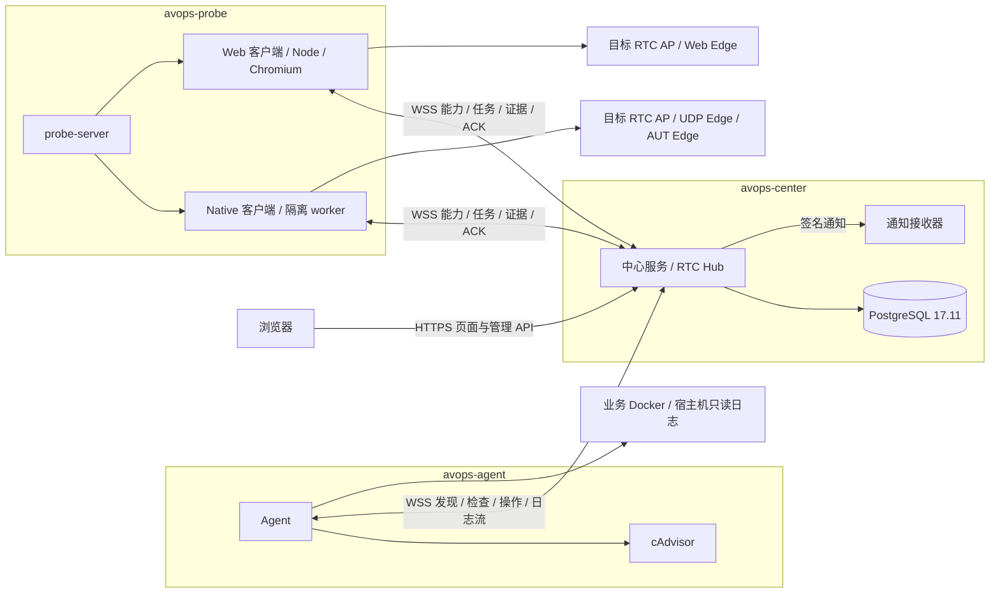

# AVOPS Monitor V1.0 · 技术实现

更新日期：2026-11-22。代码以根目录 `go.mod` 为统一模块，默认发布 Linux amd64。本文描述正式运行链路；测试替身不作为 RTC 业务成功证据。

## 1. 三个部署单元与源码边界



| 目录 | 实现边界 | 关键入口 |
| --- | --- | --- |
| `center/service/` | 主机登记、发现、基准台账、容器状态、资源、操作与业务日志 API | `http.go`、`store.go` |
| `center/rtchub/` | RTC 配置、凭证、计划、阶段调度、执行、业务状态、诊断与历史 | `hub.go`、`native_coverage.go`、`configuration.go` |
| `center/internal/` | PostgreSQL、账号权限、通知、资源历史、管理 Key | 各模块的存储和业务服务 |
| `center/frontend/` | React 19 / TypeScript / Ant Design / ECharts，统一包含源码、构建产物及 Go 嵌入入口 | `src/main.tsx`、`src/app/`、`src/features/`、`static/`、`embed.go` |
| `agent/cmd/agent/` | 登记、WSS 重连、报告、任务分流 | `main.go`、`startup_reporting.go` |
| `agent/internal/docker/` | Docker API、启动配置、进程、TCP 检查及原容器重启 | `collector.go`、`processes.go`、`restart.go` |
| `agent/internal/agent/` | 机器身份、执行账本、授权、日志收集和分块下载 | `identity.go`、`runner.go`、`log_downloads.go` |
| `probe/internal/server/` | 常驻 Native/Web 子客户端监督 | `server_linux.go` |
| `probe/probe/` | 控制连接、容量、worker、持久化补报与日志上传 | `client.go`、`delivery.go`、`worker_messages.go` |
| `probe/agoranative/` | 原版 Agora Go SDK API 与回调集成 | `runner_linux.go`、`parameters_linux.go`、`video_linux.go` |
| `probe/websdk/` | Web worker、浏览器运行页、远端统计与清理 | `custom-video/worker.mjs`、`browser/` |
| `probe/native/` | 原生网络路径采集库 | `route_capture.c` |
| `shared/` | 协议、模型、原子落盘、WAL、日志筛选、cAdvisor 客户端、子进程监督 | 代码库，不发布第四镜像 |

原版 SDK 位于 `probe/third_party/Agora-Golang-Server-SDK-2.6.6/`，保留其源码、原始示例和分发元数据。应用通过模块 `replace` 引用它，不在 SDK 中添加探测业务逻辑。

## 2. 容器进程与生命周期

### 2.1 center：容器内幂等初始化

Compose 只读取公开部署参数（URL、站点、证书路径、资源、持久目录），不使用尚未生成的秘密 env_file。/center-init 以 root 运行，校验 URL/证书后在 /private 首次生成配置、独立凭证、数据库账号、存储密钥、页面初始密码及客户端接入文件。

新站点的页面初始账号固定为 `admin / 1111`，该四位密码仅作为默认 admin 的 bootstrap 例外；注册和修改密码沿用原规则。数据库密码、系统管理秘密、接入令牌、签名秘密和存储密钥仍独立随机生成。已有账号不被 bootstrap 更新密码。

初始化在文件锁内完成。完整私有配置存在时严格沿用原秘密；发现半初始化、标记存在但文件缺失、或已有数据库却没有匹配配置时拒绝启动，不生成替代密码。首次文件写入完成并通过一致性检查后记录初始化标记，制作只读运行副本、首次 SQL 和 UID/GID 权限。

PostgreSQL 子进程以 999 运行，回环 5432；空库执行 initdb 和 SQL，已有 PGDATA 不再创建账号。根进程加载 owner 仅做 Ping/dbmigrate，随后从 center.env/database.env 构造应用环境，以 65532 启动中心；owner 不进入应用环境。接收器使用独立凭证。

Docker healthcheck 自己读取持久私有配置检查运行账号数据库及监听，不依赖把密码放进 Docker Config.Env。关键子进程退出会结束整个单元，由 Compose 配置的 restart 策略恢复；停机按接收器、中心、数据库顺序。

### 2.2 agent：私有接入文件与本机初始化

Compose 只挂载 config/agent.env 和持久数据，不把接入令牌写进公开 .env。/agent-init 读取私有文件、验证 URL/令牌、创建目录，合并主机地址和采集周期等公开覆盖值。规则文件缺省为空规则，不自动授予重启权限。

内置 cAdvisor 固定回环 18089；就绪后启动 Agent，自动使用同一容器的采集器。两进程同生命周期，Docker socket 及只读主机采集挂载由 Compose 声明。Agent 从数据目录加载已有身份/账本，中心不可达时退避重连，不重建身份。

### 2.3 probe：初始化后降权运行

Compose 启用 init，入口 /probe-server 先以 root 读取私有 probe-client.env，合并地址/位置/容量，验证共享 CPU/内存预算，准备 host/clients 权限。已有客户端数据却丢失共享身份时拒绝生成另一身份。

入口完成准备后清空附加组、降到 UID/GID 65532，之后启动 Native/Web 客户端与所有 worker。两类客户端保留独立连接、并发和目录，一类异常独立重启。健康检查读取 /proc 确认 supervisor、Native、Web 进程，不把进程存活当成媒体通过。

首次共享身份仍由原有带文件锁的身份逻辑生成；后续保持原 ID/秘密。已有 outbox 和诊断按原协议重放。每个 Native 用例为隔离进程内一个 Service/两个 Connection；Web 用例使用独立浏览器上下文，互通仍由两种 worker 协作。

## 3. center：管理入口、身份与配置提交

前端 Vite 构建到 `center/frontend/static`，由同目录的 `embed.go` 使用 Go embed 随中心二进制发布。页面入口返回登录外壳，私密数据通过鉴权 API 获取；CSP nonce、按权限展示和服务端逐路由鉴权分别承担浏览器与后端防护职责。

人类账号使用 PostgreSQL 保存 bcrypt 密码摘要、角色和会话；会话/Token 保存摘要，可撤销。固定角色为 `agora`（管理者）与 `customer_ops`（使用者）。管理系统凭证用于系统接口，独立重启 Key 只能进入其允许的重启路径，不获得账号管理、日志或探测管理能力。

基准台账和 RTC 配置均采用期望版本校验。更新请求须携带当前 revision，中心完成标准化、关联和预算检查后，作为一次持久化提交写入配置与投影。版本冲突不会静默覆盖其他修改。

RTC 任务新建时默认停用；配置编辑保留既有启用状态。启用/停用只有专用操作入口，不在普通配置中维护第二份布尔值。

## 4. agent：登记、报告与发现模型

### 4.1 首次接入与重连

1. Agent 从 `/state/agent-identity.json` 读取稳定 ID 与秘密；首次启动随机生成，0600 保存。
2. 以机器凭证建立 `/api/v1/agent/connect` WSS。未登记时使用独立站点令牌请求 `/api/v1/agent/enroll`。
3. 中心验证报告身份和来源，保存凭证摘要与主机信息；登记不依赖中心手动录入 Agent。
4. 中心发送检查计划，Agent 开始采集；断连后以同一身份重连，退避上限 30 秒。

主机名优先来自 Docker daemon 主机名，其次为操作系统。上报地址优先 `AVOPS_HOST_ADDRESS`，再使用中心观察到的来源地址，最后选择网卡地址。公网 NAT 机器应显式设置对外 IP；`ip_addresses` 同时保留有效网卡地址及地址来源。

### 4.2 报告边界

| 字段/部分 | 内容 | 保存或用途 |
| --- | --- | --- |
| `host_info` | 主机名、主 IP、网卡 IP、来源、时间 | 主机发现及 AP 入口选择 |
| `sequence`、`collected_at`、`complete` | 当前连接中的顺序、采集时间、完整性 | 防止过期/乱序快照覆盖当前状态 |
| `containers[].container` | 容器 ID、名称、镜像、状态、资源、生命周期、进程 | 当前发现与容器投影 |
| `containers[].startup` | 独立启动参数对象及 snapshot_id | 加密启动参数缓存、AP/Edge 解析、日志定位 |
| `containers[].checks` | 与当前计划逐项匹配的检查结果 | 基准台账的 TCP 健康判定 |

默认采集周期 15 秒，允许 10–60 秒。启动参数首次发送、快照变化时发送，不变时每 10 分钟刷新；每次报告仍携带启动参数是否有效。断线重连重建发送缓存，会再次上报启动参数。中心保留最后一份有效快照，按当前容器 ID、快照 ID、连接与时间判断是否过期。

快照不完整时不把未出现的容器立即判为丢失；超过消息预算时回报不完整状态，让旧观察自然过期。进程采集使用 Docker top 的 PID/comm，主进程名结合 inspect 的可执行路径修正截断，不收集业务进程完整命令行。

### 4.3 资源采样与状态

共享 `cadvisor` 客户端根据当前容器身份合并资源：CPU、内存、文件系统、磁盘 IO、网络和限制值，并保留来源、采样时间、窗口与可用性。缺少数据表示 unavailable，不填零冒充采样。Host 网络单独标明共享范围。

中心按基准成员映射当前观察。TCP 检查结果只有与当前 revision、容器身份及检查项一致时才进入连续计数；三次失败确认异常，两次成功确认恢复。资源历史每 30 秒形成有界数字样本，保留 7 天，按显示步长取实际最近样本，不混入启动参数。

容器服务列表仅轮询状态、资源与轻量 `startup_ref`；启动参数页签通过 `/api/v1/nodes/startup` 按需读取，携带节点、容器 ID 和快照 ID，快照变化时返回冲突以防错配历史参数。状态与基准配置独立读取，配置失败不阻断状态显示，但阻止依赖配置的设置操作；同一页面的普通刷新共用在途请求，写入后强制读取新结果。

监控前端缓存按 API 会话隔离，总量限制为 32 项与约 8 MiB 序列化预算。启动参数按容器身份和快照缓存，新鲜度及上报时间仍取最新轮询元数据。资源趋势按节点和时间范围缓存，重开时复用一分钟内的历史快照并后台更新，同一地址的并发读取去重；图表显示窗口截止时间，读取失败保留已有曲线并给出提示。页签和抽屉仍销毁图表 DOM，关闭后停止轮询，缓存只保存数据。

## 5. AP / Edge 自动发现与执行投影

`center/service/media_edges.go` 遍历全部有效发现和启动参数缓存，识别运行中的 `agora_local_ap` 与 UDP/AUT/Web media edge。AP 入口使用该节点上报的客户端可达地址。

Edge 优先读取 Docker Args；仅在确认为 shell `-c` 时解析字面量命令，绝不执行 shell、替换变量或命令。提取 `--ap`、`--ip-for-client`、`--user-port`，支持分隔参数和 `--name=value`，拒绝缺值、冲突值、非法 IP 和端口。按 `--ap` 形成 string → Edge 数组的分组。

中心内部保留 Agent ID、容器 ID/名称、快照 ID、stale 等溯源字段，用于关联、去重、过期与诊断。给 Probe 的具体连接入口压缩为：

```json
{"edge_type":"udp","ip_for_client":"198.51.100.20","user_port":4001}
```

AP 组名用于拓扑关联，不直接用内部 `--ap` 地址替代公网连接地址。不存在有效 AP、Edge 参数缺失或台账过期时，计划带明确问题，不能回退到写死的旧 IP 或默认端口并判通过。

## 6. RTC 配置、计划与调度

### 6.1 目标和任务

目标保存名称、AppID、鉴权模式、AP 分组与 Native/Web 私有化参数。Certificate 单独放入加密凭证区，公共响应只返回是否已配置。`taskRTC()` 从目标生成执行配置，普通任务配置不重复保存 RTC 或凭证。

任务绑定 `target_id`、`host_id/service_type/client_type`，不绑定某次进程生成的 runtime ID。服务端根据上报注册表解析实际 Native/Web 客户端。互通任务同时要求两种客户端在线、有容量并声明对应双向收发能力。

中心生成每次执行的独立频道和固定两端 UID 10001/10002；启用 Certificate 时按频道和 UID 生成短期 Token，下发 Token 而非 App Certificate。目标参数或凭证版本变化会改变执行 revision，旧结果不能用于当前配置健康判断。

### 6.2 覆盖与数量

| 阶段 | Native | Web | Native/Web |
| --- | --- | --- | --- |
| AP | UDP、AUT 两种接入路径 | AP/ticket → 分配 Web WSS | UDP↔Web、AUT↔Web 两条双向 AP 用例 |
| DIRECT | 每个 UDP/AUT 入口 | 每个 Web WSS 入口 | 不生成额外直连矩阵 |
| CROSS | Edge 环形互通 | Web Edge 环形互通 | 不穷举 Native × Web |

计划按实际 Edge 数量生成，并记录覆盖版本、成员、阶段和 case。环形覆盖避免 O(N²) 用例增长。某轮父执行保存全部 case，具体 case 作为子执行保存两端证据；阶段完成后才推进该阶段下次执行时间。

AP、DIRECT、CROSS 分别使用 `interval_seconds`、`sweep_interval_seconds`、`cross_interval_seconds`。调度检查同阶段是否已有活动执行、目标当前版本、发现新鲜度、客户端在线/能力、任务与客户端启用状态及预算。人工“运行一次”同样接受这些条件和槽位约束。

### 6.3 容量、等待与超时

实际 worker 上限由 Edge 数量、客户端声明容量与全局运行预算共同约束，不固定为八个。Native/Web 分别计数；互通按两端可用容量共同准入。未获槽位的 case 保持 PENDING，取得槽位后再创建具体执行，不提前让尚未派发的用例耗尽 SDK 执行时间。

子执行经历 PREPARING、RUNNING，最后进入 SUCCESS / FAILED / ERROR / CANCELLED。双方 ready 后统一发送 start_media；结果等待、媒体 deadline、清理宽限和上报宽限分别处理。SDK 进程退出码、信号、超时与强制取消会形成过程证据；父执行聚合全部 case，而不是看到一个成功就通过整个范围。

完成后的间隔让执行队列有界；中心还计算阶段最坏工作量，预算不足时显示调度问题。预算或离线状态不篡改已保存的媒体结果，也不刷新旧结果的时间。

## 7. Native SDK 集成与真实媒体

### 7.1 初始化与调用顺序

worker 加载固定 PCM/I420 文件，建立独立 work_dir，初始化原版 Go SDK 服务。私有化访问点通过 `SetLocalAccessPoint` 配置；连接私参在 join 前设置。UDP 使用 `rtc.enable_nasa2=false`，AUT 使用 true；直连通过 `rtc.vos_list` 指定 `ip_for_client:user_port`，AP 内部是否仍参与由 SDK 处理。

随后创建连接、注册连接/LocalUser/媒体 observer、配置音频接收和视频编码、Connect、订阅期望对端、发布音视频并送帧。不同直连/跨 Edge 用例使用隔离进程，避免全局服务配置互相覆盖。清理包括断开、释放连接和释放服务。

### 7.2 重点 API 与回调

| 环节 | 调用或回调 | 验证用途 |
| --- | --- | --- |
| 初始化 | Initialize / SetLocalAccessPoint / SetParameters | 记录实际配置和返回码，确保参数在加入前生效 |
| 建连 | NewRtcConnection / Connect；OnConnected、OnConnectionFailure、OnError、OnTokenPrivilegeDidExpire 等 | 区分连接成功、鉴权拒绝、断线和连接错误 |
| 发布 | PublishAudio / PublishVideo / SendAudioPcmData / 视频送帧；音视频发布状态回调 | 要求实际发布及送帧，返回失败即记录阶段错误 |
| 订阅 | SubscribeAudio / SubscribeVideo；用户和轨道订阅回调 | 订阅指定频道与对端 UID，订阅通知本身不是接收证据 |
| 音频 | OnPlaybackAudioFrameBeforeMixing | 校验频道、UID、采样率、声道及 PCM 缓冲，累计有效样本 |
| 视频 | RegisterVideoFrameObserver / OnRenderVideoFrame | 校验频道、UID、格式、宽高、stride 和 YUV plane 长度，累计有效解码帧 |
| 清理 | Disconnect / Connection.Release / Service.Release | 清理成功属于执行通过条件 |

此 SDK 的 `VideoFrameObserver` 实际字段是 `OnRenderVideoFrame`，没有 `OnFrame` 字段。Probe 内部的 onFrame 是应用自己的处理函数，由实际 SDK 回调调用，不是伪造一个 SDK 回调。

Native 常规固定档位：16 kHz、单声道 PCM；352×288、15 fps、400 kbps、H.264/I420 输入。默认发送 5 秒，至少 1000 ms 有效音频和 5 帧视频。互通路径使用 VP8 配合浏览器，不把浏览器不支持的编解码器当作探测链路默认值。

## 8. Web SDK 与互通

Web worker 启动 loopback 运行页，只加载镜像内 SDK、脚本和媒体，不依赖公网 CDN。当前运行版本为 Web SDK 4.24.9、Node 22.16.0、Chromium headless shell 141。

createClient/join 前配置：关闭信令/媒体 fallback proxy、`CONNECT_GATEWAY_WITHOUT_DOMAIN=true`、纯 IP 的 WEBCS_DOMAIN、上报与日志服务地址。显式 Web Edge 使用 `GATEWAY_ADDRESS=[{ip,port}]`，port 为数字；仍保留 WEBCS 获取 ticket，媒体地址通过 ICE 协商。

浏览器按期望 UID 定期采样 `getRemoteAudioStats()[uid]` 与 `getRemoteVideoStats()[uid]`，至少两次有效样本并以媒体窗口基线比较 receiveBytes/receivePackets 增量；计数重置不视为进度。音频需有有效接收码率；视频还需接收、解码、渲染帧率及宽高有效。最后一次快照丢失不能拿早期成功值代替，其他 UID 的统计不能凑数。

浏览器音频采样、视频解码和 WebRTC 统计作为交叉证据，最终同时满足音频/视频门槛。Web 固定素材为镜像内 probe.webm，按 Web 配置生成轨道，不访问宿主机摄像头或麦克风。

若 publish 的 CDP 返回因上下文丢失而中断，仅在同 UID 已连接、published 已确认且两类本地轨道仍 live 时继续接收验证；不重复 publish，也不直接判成功。浏览器崩溃与 RTC 发布失败分别记录。

互通父任务包含 UDP↔Web、AUT↔Web 两条双向用例。双方在同频道使用不同 UID，都发布并订阅对端；中心等待两种 worker ready 后同步开始媒体，按各端实际 driver 核对证据。

## 9. 路径核验与结论

Native `route_capture.c` 通过 worker 的网络调用采集地址、端口、方向、字节数和时间；不保存媒体载荷。`routeproof` 把持续媒体窗口内的网络交换与解码回调关联，验证当前实际使用的入口。

Web 关联 AP 请求、仍存活的 WSS、ICE 及实际解码音视频。指定端口连接失败后，同 IP 443 的存活连接会形成路径不符；仅“曾尝试指定端口”不算通过。AP 分配路径允许实际入口不在本地库存，但不能冒充指定 Edge 覆盖。

| 层次 | 状态/含义 |
| --- | --- |
| 单次结果 SUCCESS | 两端真实媒体、路径及清理全部满足 |
| 单次结果 FAILED | 真实业务验证不通过，如缺音频/视频、发布失败或路径不符 |
| 单次结果 ERROR | 执行、调度、进程、存储等无法完成验证 |
| 单次结果 CANCELLED | 本轮取消，不算正常证据 |
| 任务 HEALTHY | 所需覆盖阶段具有当前版本且有效的新鲜成功证据 |
| 任务 UNHEALTHY | 达到确认失败阈值；默认连续三轮失败 |
| 任务 UNKNOWN | 无新鲜证据、离线、发现过期、预算或执行问题 |
| 任务 DISABLED | 任务停用，不参与整体服务健康计算 |

默认已确认异常需连续两轮成功才恢复。Native/Web 上报心跳只说明控制链路在线，不能恢复业务健康。各阶段独立判断新鲜度；中心重启、客户端重连或容量恢复不能把旧成功时间改为现在。

## 10. Probe 控制协议、持久化与补报

控制消息版本为 2，与产品版本 V1.0 分开。共享服务器身份在 `/host/server-identity-v2.json`，按服务/客户端派生运行身份；注册时上报服务器、服务、客户端、driver、SDK/运行版本、平台、容量与能力。

| 方向 | 消息 | 用途 |
| --- | --- | --- |
| Probe → center | hello / heartbeat | 能力、资源、在线与容量 |
| center → Probe | prepare_run / start_media / finish_run / cancel_run | 准备、双方屏障、媒体和清理控制 |
| Probe → center | run_ready / telemetry_batch / run_result | 就绪、过程事件及最终证据 |
| center → Probe | telemetry_ack / result_ack | 持久化确认与幂等推进 |
| 双向 | collect_logs / log_status 等 | RTC SDK 诊断回捞与上传状态 |

worker 的新事件/结果先保存到客户端 `outbox-v2.json` 和对应执行目录，再发送。中心按执行、配置版本、角色、runtime、worker、事件 ID 校验归属；重复事件必须内容一致，不能借重放改写历史结果。

每个端点只允许一个未确认事件批次，整条连接最多四批遥测日志同时在途；ready、结果优先于遥测。ACK 状态按秒合并落盘，崩溃时可能重复重放，但稳定 ID 保证中心去重。断线不把证据变成成功，也不丢弃未确认记录来腾空间。

SDK API/回调记录保留方法、参数摘要、返回码、关联阶段、时间和 worker。高频媒体回调按窗口上报统计，原始调用记录写 sdk-api.jsonl；媒体缓冲只记长度和格式，不把 PCM/YUV 内容写进过程事件。Certificate、Token、ticket、密码等在诊断输出中脱敏。

## 11. 两类日志的存储边界

### 11.1 RTC Probe 诊断

每个 SDK Service 的日志在该用例服务目录保存；同一 Service 中的两端共用一份服务日志，端点 API/回调记录保留各自归属。中心请求诊断后，Probe 按运行、角色和服务日志范围打包，再按分块和整包 SHA-256 验证。中心保存诊断 ZIP 与元数据，受独立日志预算和保留策略控制。

### 11.2 Agent 业务日志

`POST /api/v1/log-collections` 接受 Agent、时间模式及 `service_container_ids` 数组（空数组表示整机），不接受用户任意文件路径。中心从当前 AP 参数和挂载推导宿主机日志目录，对所选 ID 去重并逐一核验当前主机归属和可用性；任一无效则拒绝整个请求。任务与结果的 `services` 数组保存容器 ID、名称、快照与进程，随 `collect_logs` 下发。Agent 逐个复核容器身份、挂载和 PID，再以进程名与 PID 的联合集合筛选日志，统一扫描并生成一个压缩包，同一文件只打包一次。前端 `LogServicePicker` 使用受控抽屉暂存勾选，提供名称搜索、类型分组、全选当前结果和只看已选；确认时统一写回表单，取消则丢弃草稿。页面显式区分指定容器与整机，只有选择整机模式才发送空数组；指定容器模式清空后阻止提交。恢复任务时保留完整选择和对应范围模式，失效选择会阻止提交。

Agent 执行前再次 inspect 校验当前容器和挂载。日志目录的符号链接按宿主机命名空间解析，例如 `/var/log/agora -> /data/log/agora` 在容器中定位为 `/host/data/log/agora`，支持相对链接和多级链接，拒绝越界、循环与不可读路径。目录内仅读取顶层普通文件，跳过符号链接、子目录；按时间分片及进程前缀/PID 精确筛选，使用 Go 原生 tar/gzip 生成包。源文件预算 1 GiB，压缩包预算 256 MiB，最多保存 16 个临时任务，过期约一小时并周期清理；新连接会清掉旧会话的临时包。

点击下载才下发 `download_logs`，Agent 每块发送 128 KiB，中心通过有界内存转发 HTTP 响应，不落盘。下载使用独立 transfer_id、顺序和大小校验，取消时发送停止指令。中心任务状态仅在内存保存；连接变化或任务失效后不能继续下载旧会话的数据。

## 12. PostgreSQL 与持久数据

| 存储 | 内容 |
| --- | --- |
| documents | 配置版本、机器登记、RTC 当前控制状态、加密凭证与启动缓存等文档 |
| baseline_versions / nodes | 台账历史与当前成员关系、检查和许可投影 |
| agent_snapshots / containers | Agent 最新快照及容器发现投影 |
| operations / operation_audit | 幂等受控操作、节点互斥及执行阶段记录 |
| users / roles / permissions / sessions | 人类账号、固定角色、权限、可撤销会话 |
| access_keys / access_audit / key_requests | 独立操作凭证、申请与相关记录 |
| notification_* | 状态事实、投递队列、配置版本及接收目标状态 |
| resource_samples | 有界数字资源历史 |
| probe_runs_v2 / probe_logs_v2 | RTC 父/子执行、端点证据与诊断元数据 |

正式中心只使用 PostgreSQL；文件后端与内存历史用于隔离回归测试，不是正式安装的第二种存储方案。旧文件导入/导出测试 API 和相关建库遗留已移除。

RTC 执行列表通过 `probe_runs_v2_public_time` 部分索引限定 `parent_run_id` 为空的父级记录，并按创建时间与执行 ID 分页；统计总数和首屏不扫描所有子执行的大型 SDK 证据 JSON。历史页使用 `/api/v1/rtc/status?view=history` 获取任务、目标和运行器元数据，不携带缓存执行与覆盖证据；完整信息由单次执行详情接口读取。前端历史请求完成后才安排下一次刷新，状态轮询不会重启未完成的历史查询。执行详情同样串行轮询，执行结束且没有待上传日志时停止，操作后主动刷新，避免反复下载已完成执行的完整数据。

任务配置等控制页面使用 `/api/v1/rtc/status?view=tasks`，只读取配置、业务状态、覆盖计划元数据和 `task_activity` 执行标记，不序列化运行缓存中的 SDK 事件、端点结果或用例明细。任务列表无需预读执行详情；打开当前覆盖后只读取选中的阶段，其他阶段卡片依据有效的阶段状态显示已确认数量。单阶段详情复用有界缓存与串行轮询，不被控制状态刷新反复重启。

详情页面使用 `/api/v1/rtc/runs/{id}?view=detail` 获取音视频证据、路径、阶段耗时和诊断包元数据，响应不携带端点的 SDK 事件数组；原始调用、回调及参数继续保存在执行归档和默认完整详情接口。投影仅复制端点后裁剪响应，不修改内存运行态或归档。`useRTCRunDetail` 优先展示列表已有记录或当前账号内最多 32 条详情缓存，并在后台刷新；相同执行的在途读取复用，操作后强制读取新结果，过期/不存在的执行不会被缓存伪装为有效记录。离开执行后旧响应不能覆盖新路径，返回父/子详情时复用已知结果，面包屑也复用已加载的父记录。

独立 32 字节存储密钥用于 AES-GCM 加密控制凭证、通知秘密和启动参数。密码使用 bcrypt；机器秘密、会话和管理 Key 的验证采用摘要。数据库 advisory lock 限制同一中心状态只有一个写者，写者失效后不能静默另取连接继续写。

默认资源历史 7 天；RTC 执行历史 7 天 / 2048 MiB、中心 RTC 诊断 2048 MiB；Probe 成功数据 60 分钟、失败数据 1440 分钟、本机预算 1024 MiB。保留设置有版本号并下发 Probe。尚未确认的本地结果/事件不得因普通配额清理被删除。

## 13. 受控重启与业务通知

中心重启请求绑定 request_key、节点、原容器 ID、镜像、快照及许可。Agent 本机规则再次验证精确绑定；执行前写 tasks.jsonl。正常阶段包含准备、执行和最终结果，重复 task/query 根据 operation_id 与本机 ledger 返回已有状态，不再次执行 Docker 写操作。

进程重启发现上次停在 EXECUTING 时标记 UNCERTAIN；中心只有在确认结果后解除互斥或由有权限的人员核实。鉴权、事实与操作审计在中心/Agent 对应模块完成，不让 Probe 上报一套独立“状态与操作审计”。

通知模块接收容器和 RTC 业务状态事实，按订阅目标生成稳定事件并持久化重试。接收器校验 HMAC、事件类别、归属与重复 ID；相同 ID 不同内容拒绝。投递失败不改变原始媒体执行结论。

## 14. 构建、交付和验证边界

Go 1.24、Node 22 用于开发侧构建；Native 另需 Linux amd64、CGO、C 编译器、pkg-config、FFmpeg。各角色 deploy 包和 centerctl/agentctl/probectl 只构建自身镜像，根目录 avops-release 只校验/组包。

离线包包含三镜像 tar、三个角色的 compose.yaml/.env.example、公开源码与文档，不再分发宿主机 Go 安装、初始化、升级程序。Compose 使用 pull_policy: never；镜像通过 docker load 加载。生成的 config、身份、数据库和证书私钥不进入包。

校验要求 linux/amd64、V1.0、three-images 和 compose-v1 标记及正确入口；每个角色 Compose 只有一个服务，使用对应镜像。完整包逐文件 SHA256，路径与 ZIP 解压拒绝穿越。SDK 依赖采用固定 URL/SHA，Native 编译使用临时 SDK 副本，不改第三方源码。浏览器依赖含 NSS 提供者、SQLite、字体和根证书，需实际 HTTPS 验证。

回归覆盖初始化幂等/半状态、秘密不变、证书、身份、资源预算、权限、持久化、幂等操作、调度、媒体验证、补报、日志、页面和离线包。隔离 Compose 验收使用新目录与临时容器，中心验证首次启动/重启/缺文件保护，Agent/Probe 验证健康、身份保持及降权。正式迁移复用原数据与秘密并保留原容器；真实媒体验收还需发起实际 RTC 任务。
